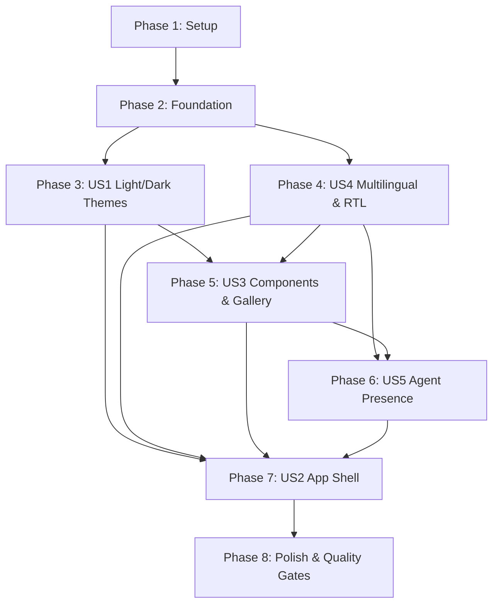

# Tasks: 002-visual-foundation

**Input**: Design documents from `/specs/002-visual-foundation/` (`spec.md`, `plan.md`, `research.md`, `data-model.md`, `quickstart.md`, `contracts/agent-events.json`)
**Prerequisites**: `plan.md`, `spec.md`, `data-model.md`, `research.md`
**Tests**: Derived directly from acceptance criteria in `spec.md` (Vitest for component/unit tests, Playwright for e2e/a11y/visual tests).
**Organization**: Tasks are grouped by user story to enable independent implementation, review, and verification.

## Format: `- [ ] [ID] [P?] [Story] Description with file path`

- **[P]**: Can run in parallel (different files, no blocking dependencies on incomplete tasks)
- **[Story]**: Which user story this task belongs to (`[US1]`, `[US2]`, `[US3]`, `[US4]`, `[US5]`)
- Every task includes an explicit file path.

---

## Phase 1: Setup (Shared Infrastructure & Dependencies)

**Purpose**: Install required runtime & dev dependencies, configure fonts, and set up base styling configuration.

- [x] T001 Install UI and localization dependencies (`next-intl`, `@tabler/icons-react`, `clsx`, `tailwind-merge`, and dev testing packages `@testing-library/react`, `@testing-library/jest-dom`, `@axe-core/playwright`, `happy-dom`) in `package.json`
- [x] T002 [P] Create web font loaders for Inter, Instrument Serif, and Noto Sans Arabic using `next/font/google` in `src/lib/fonts.ts`
- [x] T003 [P] Create and configure Tailwind CSS configuration with design system tokens and semantic spacing in `tailwind.config.ts` and `postcss.config.mjs`

---

## Phase 2: Foundational (Blocking Prerequisites for All User Stories)

**Purpose**: Core CSS custom properties, theme cookie resolution, and Next.js App Router root layout that all subsequent user stories depend upon.

**⚠️ CRITICAL**: Must be completed before user story implementation begins.

- [x] T004 Define full set of semantic color tokens (`--bg`, `--surface`, `--surface-raised`, `--border`, `--text`, `--muted`, `--accent`, `--accent-soft`, `--on-accent`, `--button`, `--on-button`, `--success`, `--danger`, agent tokens) for `:root[data-theme="dark"]` and `:root[data-theme="light"]` in `src/app/globals.css`
- [x] T005 [P] Implement theme resolution and cookie storage helper functions (`getThemeFromCookies`, `setThemeCookie`) in `src/lib/theme.ts`
- [x] T006 [P] Create theme unit tests for server cookie parsing, default fallback, and preference resolution in `tests/unit/theme.test.ts`
- [x] T007 Implement Next.js 15 App Router root HTML layout with zero-flash blocking theme script and font variables in `src/app/layout.tsx`

**Checkpoint**: Foundation ready — server sets `data-theme` on `<html>` with zero flash, tokens available to all Tailwind classes.

---

## Phase 3: User Story 1 — Light and Dark Themes (Priority: P1) 🎯 MVP

**Goal**: Provide full light and dark mode switching conforming to system preference with cookie persistence, zero flash on reload, and WCAG AA contrast.

**Independent Test**: Load page with OS dark theme -> dark mode renders immediately. Toggle to light mode -> switches instantaneously, persists across page reload without FOUC.

### Tests for User Story 1

- [x] T008 [P] [US1] Create unit tests for client-side theme context and media query listener in `tests/unit/theme-context.test.tsx`
- [x] T009 [P] [US1] Create Playwright E2E test asserting zero-flash theme persistence across page reloads in `tests/e2e/theme.spec.ts`

### Implementation for User Story 1

- [x] T010 [P] [US1] Create client-side `ThemeProvider` and `useTheme` hook with system preference listener in `src/components/common/ThemeProvider.tsx`
- [x] T011 [US1] Create accessible `ThemeToggle` button component with light/dark/system options and focus ring in `src/components/common/ThemeToggle.tsx`
- [x] T012 [US1] Verify and enforce WCAG AA color contrast ratios (≥ 4.5:1 normal text, ≥ 3:1 large text) for all token pairings in `src/app/globals.css`

**Checkpoint**: User Story 1 complete — Theme switching operates seamlessly with zero flash in SSR and client hydration.

---

## Phase 4: User Story 4 — Multilingual Support & Right-to-Left (RTL) Layout (Priority: P1)

_Note: Scheduled before Shell and Components so that all layout containers and text elements are natively localized and bidirectional from inception._

**Goal**: Support English (`en`), French (`fr`), and Arabic (`ar`) with full RTL mirroring for Arabic, correct mixed-direction text isolation, and cookie persistence.

**Independent Test**: Switch language to Arabic via selector -> layout mirrors to right, `dir="rtl"` applied, typography switches to Noto Sans Arabic, and Latin brand names maintain correct bidirectional reading order.

### Tests for User Story 4

- [x] T013 [P] [US4] Create unit test for translation message resolution, fallback to English, and RTL direction mapper in `tests/unit/i18n.test.ts`
- [x] T014 [P] [US4] Create Playwright E2E test verifying `dir="rtl"` layout mirroring, font application, and mixed-direction rendering in `tests/e2e/rtl.spec.ts`

### Implementation for User Story 4

- [x] T015 [P] [US4] Create translation message catalogs for English, French, and Arabic in `messages/en.json`, `messages/fr.json`, and `messages/ar.json`
- [x] T016 [P] [US4] Configure `next-intl` request routing and locale resolution in `src/i18n/request.ts` and `src/i18n/routing.ts`
- [x] T017 [US4] Update Next.js middleware to integrate `next-intl` locale negotiation with request ID tracing in `src/middleware.ts`
- [x] T018 [US4] Create accessible `LocaleSwitcher` dropdown component supporting `en`, `fr`, and `ar` in `src/components/common/LocaleSwitcher.tsx`
- [x] T019 [US4] Refactor root localized layout wrapper to inject `lang`, `dir`, font classes, and `NextIntlClientProvider` in `src/app/[locale]/layout.tsx`

**Checkpoint**: User Story 4 complete — Localized routing (`/[locale]`) and RTL bidirectional layout foundation active.

---

## Phase 5: User Story 3 — Core Component Library & Design Gallery (Priority: P1)

**Goal**: Deliver reusable, accessible UI component primitives (Button, Chip, Card, Input, Toast) conforming to the design system and showcase them on a `/design` gallery route.

**Independent Test**: Visit `/design` -> interactive showcase displaying all tokens, buttons, chips, tags, inputs, toasts, and post cards across light/dark themes and LTR/RTL directions.

### Tests for User Story 3

- [x] T020 [P] [US3] Create component unit tests for Button, Chip, Card, and Input variants in `tests/unit/components.test.tsx`
- [x] T021 [P] [US3] Create Playwright automated accessibility audit (`@axe-core/playwright`) asserting 0 WCAG AA violations on `/design` in `tests/e2e/a11y.spec.ts`

### Implementation for User Story 3

- [x] T022 [P] [US3] Create accessible `Button` component (primary, secondary, 44px round icon send button, focus ring) in `src/components/ui/Button.tsx`
- [x] T023 [P] [US3] Create accessible `Chip` component (filter/selection, interactive button, status tag) in `src/components/ui/Chip.tsx`
- [x] T024 [P] [US3] Create `Card` and `PostCard` components with status tag, formatted body, image prompt divider, and action buttons in `src/components/ui/Card.tsx`
- [x] T025 [P] [US3] Create accessible `Input` and multiline textarea components with label/aria-label and `dir="auto"` in `src/components/ui/Input.tsx`
- [x] T026 [P] [US3] Create accessible `Toast` container with `role="status"` and 4s auto-dismiss in `src/components/ui/Toast.tsx`
- [x] T027 [US3] Build interactive component gallery page showcasing all design tokens, typography scale, and components in `src/app/[locale]/design/page.tsx`

**Checkpoint**: User Story 3 complete — Complete design system primitives implemented, verified accessible, and showcased in `/design`.

---

## Phase 6: User Story 5 — Transparent Agent Presence & Timeline (Priority: P1)

**Goal**: Build the active-agent chip and activity timeline component rendering the 5 pipeline states (`done`, `working`, `waiting`, `paused`, `failed`) with pulse animations and `prefers-reduced-motion` compliance.

**Independent Test**: Feed timeline a list of mock events -> renders color dots, agent names, status lines, pulsing active state, paused retry countdowns, and failed reason labels accurately.

### Tests for User Story 5

- [x] T028 [P] [US5] Create unit tests for agent state styling, duration formatting, and timeline event reducer in `tests/unit/agent-timeline.test.tsx`
- [x] T029 [P] [US5] Create Playwright E2E test verifying working-agent pulse animation and reduced-motion suppression in `tests/e2e/agent-presence.spec.ts`

### Implementation for User Story 5

- [x] T030 [P] [US5] Define agent constants, semantic color map, event types, and mock fixture data in `src/lib/agent-events.ts`
- [x] T031 [P] [US5] Create `AgentChip` component with agent dot, capitalized name, and one-line status in `src/components/agent/AgentChip.tsx`
- [x] T032 [US5] Create `ActivityTimeline` component rendering ordered steps with all 5 states, durations, and retry countdowns in `src/components/agent/ActivityTimeline.tsx`
- [x] T033 [US5] Implement CSS working-agent pulse keyframes (1.2s ease-in-out) and `@media (prefers-reduced-motion: reduce)` override in `src/app/globals.css`
- [x] T034 [US5] Integrate AgentChip and ActivityTimeline into the `/design` component gallery page in `src/app/[locale]/design/page.tsx`

**Checkpoint**: User Story 5 complete — Full agent presence and transparent activity timeline functioning with mock event lists.

---

## Phase 7: User Story 2 — Responsive Application Shell (Priority: P1)

**Goal**: Build the responsive 3-section layout (left sidebar / mobile drawer, main workspace, bottom pinned composer) hosting the top header and active agent chip.

**Independent Test**: View `/` on desktop -> 240px sidebar, 56px header, max-876px workspace, pinned composer. Resize < 760px -> sidebar collapses to drawer with accessible menu button toggle and focus trap.

### Tests for User Story 2

- [x] T035 [P] [US2] Create unit test for responsive drawer hook, mobile breakpoint detection, and focus trap in `tests/unit/drawer.test.tsx`
- [x] T036 [P] [US2] Create Playwright E2E test for responsive shell layout, sidebar toggle on <760px, and keyboard navigation traversal in `tests/e2e/shell.spec.ts`

### Implementation for User Story 2

- [x] T037 [P] [US2] Create `AppHeader` component (56px fixed, title, active-agent chip, theme/locale controls, mobile menu button) in `src/components/layout/AppHeader.tsx`
- [x] T038 [P] [US2] Create `Sidebar` component (240px desktop sidebar, nav items, recent runs, mobile off-canvas drawer with backdrop) in `src/components/layout/Sidebar.tsx`
- [x] T039 [P] [US2] Create bottom pinned `Composer` component (radius 18px, transparent input, agent chip, platform selection chips, send button, disclaimer text) in `src/components/layout/Composer.tsx`
- [x] T040 [US2] Assemble main application shell layout and workspace canvas in `src/app/[locale]/page.tsx`

**Checkpoint**: User Story 2 complete — Complete responsive application shell active and accessible across desktop and mobile.

---

## Phase 8: Polish & Cross-Cutting Concerns

**Purpose**: End-to-end verification, keyboard navigation audit, and documentation updates.

- [x] T041 Run automated accessibility check across all routes (`/` and `/design`) in dark, light, LTR, and RTL modes
- [x] T042 Run full test suite (`pnpm test`, `pnpm test:e2e`), linter (`pnpm lint`), and type checker (`pnpm type-check`) to guarantee zero errors
- [x] T043 Update `README.md` and feature documentation with instructions for viewing design gallery and testing visual features

---

## Dependencies & Execution Order

