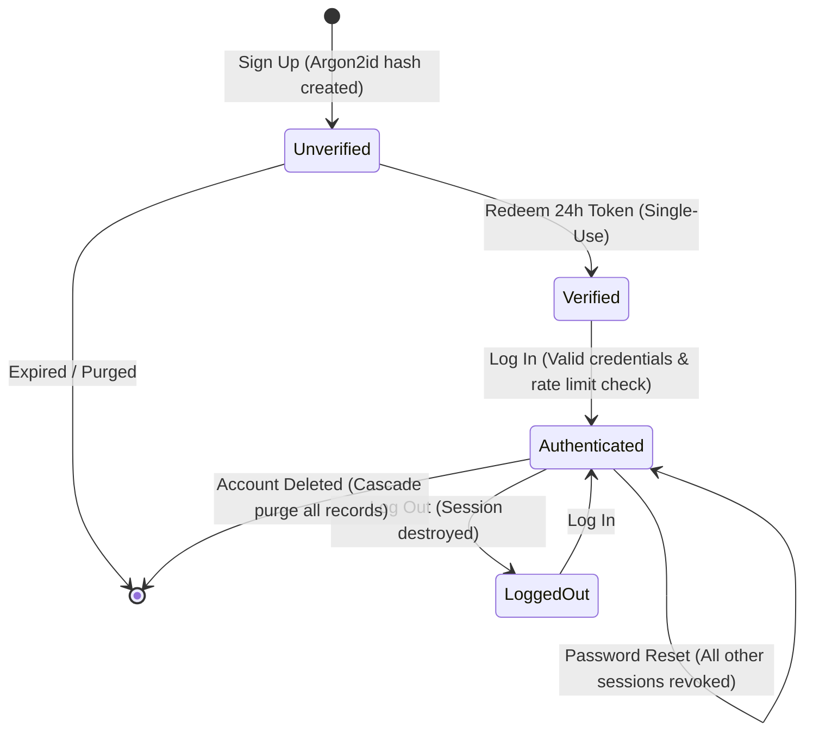

# Data Models & Contracts: 003-accounts-auth

**Branch**: `003-accounts-auth` | **Date**: 2026-10-23

This document specifies the database schemas, entity relationships, validation rules, state transitions, and API/action contracts for the accounts and authentication system.

---

## 1. Database Schema (`src/lib/db/schema.ts`)

### 1.1 Users Table (`users`)

Stores registered professionals with email verification status.

```typescript
export const users = pgTable('users', {
  id: uuid('id')
    .primaryKey()
    .default(sql`gen_random_uuid()`),
  email: varchar('email', { length: 320 }).notNull().unique(),
  passwordHash: varchar('password_hash', { length: 255 }).notNull(),
  emailVerified: boolean('email_verified').default(false).notNull(),
  googleId: varchar('google_id', { length: 255 }).unique(), // Optional social login
  createdAt: timestamp('created_at', { withTimezone: true })
    .defaultNow()
    .notNull(),
  updatedAt: timestamp('updated_at', { withTimezone: true })
    .defaultNow()
    .notNull(),
});
```

### 1.2 Sessions Table (`sessions`)

Server-side session management for authenticated users.

```typescript
export const sessions = pgTable('sessions', {
  id: varchar('id', { length: 64 }).primaryKey(), // SHA-256 hash of the session token
  userId: uuid('user_id')
    .notNull()
    .references(() => users.id, { onDelete: 'cascade' }),
  expiresAt: timestamp('expires_at', { withTimezone: true }).notNull(),
  createdAt: timestamp('created_at', { withTimezone: true })
    .defaultNow()
    .notNull(),
});
```

### 1.3 Email Verification Tokens Table (`verification_tokens`)

Single-use tokens with 24-hour expiration for email address verification.

```typescript
export const verificationTokens = pgTable('verification_tokens', {
  id: uuid('id')
    .primaryKey()
    .default(sql`gen_random_uuid()`),
  userId: uuid('user_id')
    .notNull()
    .references(() => users.id, { onDelete: 'cascade' }),
  tokenHash: varchar('token_hash', { length: 64 }).notNull().unique(), // SHA-256 hash of token
  expiresAt: timestamp('expires_at', { withTimezone: true }).notNull(),
  usedAt: timestamp('used_at', { withTimezone: true }),
  createdAt: timestamp('created_at', { withTimezone: true })
    .defaultNow()
    .notNull(),
});
```

### 1.4 Password Reset Tokens Table (`password_reset_tokens`)

Single-use tokens with 1-hour expiration for account password recovery.

```typescript
export const passwordResetTokens = pgTable('password_reset_tokens', {
  id: uuid('id')
    .primaryKey()
    .default(sql`gen_random_uuid()`),
  userId: uuid('user_id')
    .notNull()
    .references(() => users.id, { onDelete: 'cascade' }),
  tokenHash: varchar('token_hash', { length: 64 }).notNull().unique(), // SHA-256 hash of token
  expiresAt: timestamp('expires_at', { withTimezone: true }).notNull(),
  usedAt: timestamp('used_at', { withTimezone: true }),
  createdAt: timestamp('created_at', { withTimezone: true })
    .defaultNow()
    .notNull(),
});
```

---

## 2. State Transitions & Validation Rules

### 2.1 User Lifecycle Transitions



### 2.2 Zod Validation Schemas

```typescript
export const signupSchema = z.object({
  email: z.string().email('Invalid email address').max(320),
  password: z
    .string()
    .min(10, 'Password must be at least 10 characters')
    .max(128),
});

export const loginSchema = z.object({
  email: z.string().email('Invalid email address'),
  password: z.string().min(1, 'Password is required'),
});

export const forgotPasswordSchema = z.object({
  email: z.string().email('Invalid email address'),
});

export const resetPasswordSchema = z.object({
  token: z.string().min(32),
  password: z
    .string()
    .min(10, 'Password must be at least 10 characters')
    .max(128),
});

export const deleteAccountSchema = z.object({
  currentPassword: z.string().min(1, 'Current password is required'),
  confirmationText: z
    .string()
    .refine((val) => val === 'DELETE' || val === 'حذف', {
      message: 'Please type the exact confirmation word',
    }),
});
```

---

## 3. API & Server Action Contracts

### 3.1 `POST /api/auth/signup`

- **Request Body**: `{ email, password }`
- **Response**:
  - `201 Created`: `{ success: true, message: "Verification link sent" }`
  - `400 Bad Request`: `{ error: "Validation error" }`

### 3.2 `GET /api/auth/verify?token=...`

- **Query Param**: `token` (plaintext hex string)
- **Response**:
  - `303 See Other`: Redirects to `/[locale]/` with `saouti-session` cookie set upon success.
  - `400 Bad Request` / `410 Gone`: Redirects to `/[locale]/verify-email?error=expired`

### 3.3 `POST /api/auth/login`

- **Request Body**: `{ email, password }`
- **Response**:
  - `200 OK`: Sets `saouti-session` cookie (`HttpOnly; Secure; SameSite=Lax; Path=/; Max-Age=1209600`), returns `{ success: true }`
  - `401 Unauthorized`: `{ error: "Invalid email or password" }` (constant-time, generic error)
  - `429 Too Many Requests`: `{ error: "Too many failed attempts. Please try again in 15 minutes." }`

### 3.4 `POST /api/auth/logout`

- **Request**: Authenticated session cookie
- **Response**:
  - `200 OK`: Clears `saouti-session` cookie and destroys session record in PostgreSQL/Redis.

### 3.5 `POST /api/auth/forgot-password`

- **Request Body**: `{ email }`
- **Response**:
  - `200 OK`: `{ success: true, message: "If an account exists, a link has been sent." }` (Always returns 200, never reveals email existence)

### 3.6 `POST /api/auth/reset-password`

- **Request Body**: `{ token, password }`
- **Response**:
  - `200 OK`: Updates hash, revokes token, revokes all sessions, returns `{ success: true }`
  - `400 Bad Request`: `{ error: "Invalid or expired reset token" }`

### 3.7 `POST /api/auth/delete-account`

- **Request Body**: `{ currentPassword, confirmationText }`
- **Response**:
  - `200 OK`: Permanently purges user, clears session cookie, returns `{ success: true }`
  - `401 Unauthorized`: `{ error: "Incorrect password" }`
