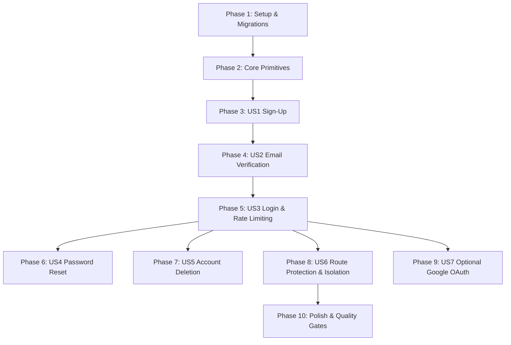

# Tasks: 003-accounts-auth

**Input**: Design documents from `/specs/003-accounts-auth/` (`spec.md`, `plan.md`, `research.md`, `data-model.md`, `quickstart.md`)
**Prerequisites**: `plan.md`, `spec.md`, `data-model.md`, `research.md`
**Tests**: Derived directly from acceptance criteria in `spec.md` (Vitest for unit/integration/data-isolation tests, Playwright for e2e auth flows).
**Organization**: Tasks are grouped by user story to enable independent implementation, review, and verification.

## Format: `- [ ] [ID] [P?] [Story] Description with file path`

- **[P]**: Can run in parallel (different files, no blocking dependencies on incomplete tasks)
- **[Story]**: Which user story this task belongs to (`[US1]`, `[US2]`, `[US3]`, `[US4]`, `[US5]`, `[US6]`, `[US7]`)
- Every task includes an explicit file path.

---

## Phase 1: Setup (Dependencies & Database Migration)

**Purpose**: Install required cryptographic libraries and migrate database schema to support sessions, email verification, and password resets.

- [x] T001 Install `@node-rs/argon2` runtime dependency in `package.json`
- [x] T002 [P] Update Drizzle database schema with `sessions`, `verificationTokens`, and `passwordResetTokens` tables in `src/lib/db/schema.ts`
- [x] T003 Generate and apply Drizzle database migration for authentication tables in `src/lib/db/migrations/`

---

## Phase 2: Foundational (Core Auth Libraries & Security Utilities)

**Purpose**: Cryptographic password hashing, single-use token hashing, Redis sliding-window rate limiting, and email service abstraction.

**⚠️ CRITICAL**: Must be completed before user story endpoint implementation begins.

- [x] T004 [P] Implement Argon2id password hashing and constant-time verification functions in `src/lib/auth/password.ts`
- [x] T005 [P] Create unit tests for Argon2id hashing and timing attack resistance in `tests/unit/password.test.ts`
- [x] T006 [P] Implement single-use token generator (256-bit entropy) and SHA-256 hash verifier in `src/lib/auth/tokens.ts`
- [x] T007 [P] Create unit tests for token expiration and single-use invalidation in `tests/unit/tokens.test.ts`
- [x] T008 [P] Implement Redis sliding-window rate limiter for IP and target email in `src/lib/auth/rate-limit.ts`
- [x] T009 [P] Create unit tests for Redis sliding-window rate limiting in `tests/unit/rate-limit.test.ts`
- [x] T010 [P] Implement `EmailService` abstraction (Console in development/test, Resend/SMTP in production) in `src/lib/auth/email.ts`
- [x] T011 Implement database-backed session creation, cookie helpers, and server-side validation in `src/lib/auth/session.ts`

**Checkpoint**: Foundation ready — Cryptographic primitives, rate limiting, session storage, and email services active and unit tested.

---

## Phase 3: User Story 1 — Professional Sign-Up & Password Hashing (Priority: P1) 🎯 MVP

**Goal**: Enable new professionals to sign up with email and a 10+ character password, hashed with Argon2id, creating an unverified account.

**Independent Test**: Post valid signup data to `/api/auth/signup` -> unverified user created in PostgreSQL with salted hash, verification token generated, zero plaintext password logged.

### Tests for User Story 1

- [ ] T012 [P] [US1] Create integration test for `POST /api/auth/signup` validating input rules, Argon2id storage, and duplicate email generic response in `tests/integration/signup.test.ts`

### Implementation for User Story 1

- [x] T013 [P] [US1] Define authentication messages and labels for English, French, and Arabic in `messages/en.json`, `messages/fr.json`, and `messages/ar.json`
- [x] T014 [US1] Implement signup API endpoint with Zod validation and email dispatch in `src/app/api/auth/signup/route.ts`
- [x] T015 [US1] Create accessible, localized `SignUpForm` component in `src/app/[locale]/(auth)/signup/page.tsx`

**Checkpoint**: User Story 1 complete — Users can register securely with strong password policies.

---

## Phase 4: User Story 2 — Single-Use Email Verification (Priority: P1)

**Goal**: Verify user email via single-use 24-hour token link, transitioning account to `emailVerified = true` and issuing an initial session.

**Independent Test**: Redeem valid token via `/api/auth/verify` -> account verified, session cookie set, redirected to workspace. Re-clicking link fails with expired/used notice.

### Tests for User Story 2

- [ ] T016 [P] [US2] Create integration test for email verification (valid token, expired token, reused token) in `tests/integration/verify-email.test.ts`

### Implementation for User Story 2

- [x] T017 [US2] Implement verification endpoint with transaction-safe single-use token consumption and session establishment in `src/app/api/auth/verify/route.ts`
- [x] T018 [US2] Create accessible `VerifyEmailNotice` page with "Resend verification link" action in `src/app/[locale]/(auth)/verify-email/page.tsx`

**Checkpoint**: User Story 2 complete — Unverified users cannot bypass verification; token redemption operates reliably.

---

## Phase 5: User Story 3 — Secure Log In, Log Out & Rate Limiting (Priority: P1)

**Goal**: Verified user login with generic error messages on failure, Redis sliding-window brute-force rate limiting (5 attempts / 15 min), and secure server-side logout.

**Independent Test**: Correct credentials establish `saouti-session` cookie. Incorrect credentials return generic error. 6th failed attempt triggers HTTP 429. Logout destroys session on server.

### Tests for User Story 3

- [ ] T019 [P] [US3] Create integration tests for login credential validation, generic error masking, and logout session revocation in `tests/integration/login.test.ts`
- [ ] T020 [P] [US3] Create integration test asserting rate limit triggers on 6th failed login attempt in `tests/integration/auth-rate-limit.test.ts`

### Implementation for User Story 3

- [x] T021 [US3] Implement login API endpoint with Argon2id verification, rate limit checks, and session cookie issuance in `src/app/api/auth/login/route.ts`
- [x] T022 [US3] Implement logout API endpoint destroying session in database and clearing cookie in `src/app/api/auth/logout/route.ts`
- [x] T023 [US3] Create accessible, localized `LoginForm` page with error alert and links to signup/forgot-password in `src/app/[locale]/(auth)/login/page.tsx`

**Checkpoint**: User Story 3 complete — Complete credential authentication and anti-brute-force defense operating.

---

## Phase 6: User Story 4 — Privacy-Preserving Password Reset (Priority: P1)

**Goal**: Request single-use 1-hour password reset link without revealing whether the email exists, and reset password while revoking all other active sessions.

**Independent Test**: Submit unknown email -> identical success message shown. Submit registered email -> 1-hour token dispatched. Reset password -> all active sessions across devices invalidated.

### Tests for User Story 4

- [ ] T024 [P] [US4] Create integration test for password reset request (enumeration resistance) and token completion in `tests/integration/password-reset.test.ts`

### Implementation for User Story 4

- [x] T025 [US4] Implement forgot-password API endpoint dispatching 1-hour token and returning constant generic response in `src/app/api/auth/forgot-password/route.ts`
- [x] T026 [US4] Implement reset-password API endpoint updating hash, revoking token, and invalidating all sessions in `src/app/api/auth/reset-password/route.ts`
- [x] T027 [US4] Create accessible `ForgotPasswordPage` and `ResetPasswordPage` forms in `src/app/[locale]/(auth)/forgot-password/page.tsx` and `src/app/[locale]/(auth)/reset-password/page.tsx`

**Checkpoint**: User Story 4 complete — Secure, enumeration-resistant password recovery implemented.

---

## Phase 7: User Story 5 — Complete & Irreversible Account Deletion (Priority: P1)

**Goal**: Allow users to permanently delete their account and cascade-purge all data after confirming their current password and typing "DELETE".

**Independent Test**: Submit deletion request with wrong password -> rejected. Submit with correct password and confirmation -> user and all sessions/tokens deleted from DB, session terminated.

### Tests for User Story 5

- [ ] T028 [P] [US5] Create integration test verifying cascade deletion of user records and session destruction in `tests/integration/account-deletion.test.ts`

### Implementation for User Story 5

- [x] T029 [US5] Implement account deletion endpoint requiring password re-auth and executing transactional cascade purge in `src/app/api/auth/delete-account/route.ts`
- [x] T030 [US5] Create accessible `AccountSettingsPage` with deletion dialog in `src/app/[locale]/settings/account/page.tsx`

**Checkpoint**: User Story 5 complete — Full user privacy and data deletion rights enforced.

---

## Phase 8: User Story 6 — Route Protection & Strict Data Isolation (Priority: P1)

**Goal**: Enforce authentication in Next.js middleware for protected routes and verify that no user can access or mutate another user's data.

**Independent Test**: Unauthenticated request to `/` redirects to `/login`. Automated multi-tenant test creates User A and User B and asserts that User B receives 404/403 when requesting User A's resources.

### Tests for User Story 6

- [x] T031 [P] [US6] Create automated multi-tenant data isolation test proving User A cannot read or write User B's records in `tests/integration/data-isolation.test.ts`

### Implementation for User Story 6

- [x] T032 [US6] Update Next.js middleware to verify session cookie and redirect unauthenticated requests on protected routes in `src/middleware.ts`
- [x] T033 [US6] Update navigation header and sidebar with user profile state and Log Out trigger in `src/components/layout/AppHeader.tsx` and `src/components/layout/Sidebar.tsx`

**Checkpoint**: User Story 6 complete — Strict tenant isolation and middleware route protection guaranteed.

---

## Phase 9: User Story 7 — Optional Google Social Sign-In (Priority: P2)

**Goal**: Optional one-click Google OAuth2 sign-in with PKCE and state verification.

- [ ] T034 [P] [US7] Implement Google OAuth2 authorization URL generator with PKCE and state token in `src/lib/auth/google.ts`
- [ ] T035 [US7] Implement Google OAuth callback route handling account creation and session issuance in `src/app/api/auth/callback/google/route.ts`
- [ ] T036 [US7] Add "Continue with Google" button to login and signup pages in `src/components/ui/Button.tsx`

---

## Phase 10: Polish & Quality Gates

**Purpose**: End-to-end verification, accessibility audits, and documentation updates.

- [ ] T037 Create Playwright E2E test covering the complete signup -> verify -> login -> logout flow in English and Arabic in `tests/e2e/auth.spec.ts`
- [ ] T038 Run automated accessibility audit on all auth views (`/login`, `/signup`, `/forgot-password`, `/reset-password`, `/settings/account`) with `@axe-core/playwright`
- [x] T039 Run full test suite (`pnpm test`), linter (`pnpm lint`), type checker (`pnpm type-check`), and production build (`pnpm build`) to ensure 0 errors

---

## Dependencies & Execution Order

