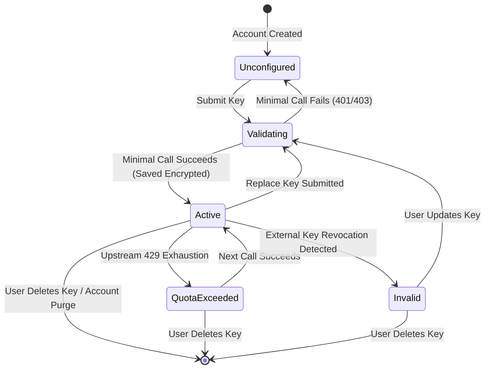

# Data Model & Contracts: 004-ai-provider-keys

**Branch**: `004-ai-provider-keys`  
**Date**: 2026-10-23  
**Status**: Ready  
**Spec Reference**: [`specs/004-ai-provider-keys/spec.md`](file:///c:/Users/Ramzi/.gemini/antigravity/scratch/Saouti/specs/004-ai-provider-keys/spec.md)

---

## 1. Database Schema (Drizzle ORM)

### 1.1 `api_keys` Table
Stores user API keys encrypted at rest using AES-256-GCM. Plaintext keys are never persisted.

```typescript
// src/lib/db/schema.ts
import { pgTable, text, timestamp, uuid, uniqueIndex, integer } from 'drizzle-orm/pg-core';
import { users } from './schema';

export const apiKeys = pgTable(
  'api_keys',
  {
    id: uuid('id').defaultRandom().primaryKey(),
    userId: uuid('user_id')
      .notNull()
      .references(() => users.id, { onDelete: 'cascade' }),
    provider: text('provider').notNull().default('gemini'), // 'gemini' (extensible to future providers)
    encryptedKey: text('encrypted_key').notNull(),          // Hex-encoded AES-256-GCM ciphertext
    nonce: text('nonce').notNull(),                         // Hex-encoded 12-byte initialization vector (IV)
    authTag: text('auth_tag').notNull(),                    // Hex-encoded 16-byte authentication tag
    lastFour: text('last_four').notNull(),                  // E.g. "Ab12" for user UI identification
    status: text('status').notNull().default('active'),     // 'active' | 'invalid' | 'quota_exceeded'
    lastValidatedAt: timestamp('last_validated_at', { withTimezone: true }),
    createdAt: timestamp('created_at', { withTimezone: true }).defaultNow().notNull(),
    updatedAt: timestamp('updated_at', { withTimezone: true }).defaultNow().notNull(),
  },
  (table) => [
    uniqueIndex('user_provider_idx').on(table.userId, table.provider),
  ]
);
```

### 1.2 `usage_counters` Table
Aggregates daily usage statistics per user to display the 7-day usage indicator in Settings without exposing prompt text or user secrets.

```typescript
export const usageCounters = pgTable(
  'usage_counters',
  {
    id: uuid('id').defaultRandom().primaryKey(),
    userId: uuid('user_id')
      .notNull()
      .references(() => users.id, { onDelete: 'cascade' }),
    provider: text('provider').notNull().default('gemini'),
    date: text('date').notNull(),                           // YYYY-MM-DD format (UTC)
    requestCount: integer('request_count').notNull().default(0),
    errorCount: integer('error_count').notNull().default(0),
    quotaErrorCount: integer('quota_error_count').notNull().default(0),
    estimatedTokens: integer('estimated_tokens').notNull().default(0),
    createdAt: timestamp('created_at', { withTimezone: true }).defaultNow().notNull(),
    updatedAt: timestamp('updated_at', { withTimezone: true }).defaultNow().notNull(),
  },
  (table) => [
    uniqueIndex('user_provider_date_idx').on(table.userId, table.provider, table.date),
  ]
);
```

---

## 2. Zod Validation Schemas

### 2.1 API Key Input Schema
Validates user submission on `POST /api/settings/keys` and `PUT /api/settings/keys`.

```typescript
import { z } from 'zod';

export const SaveApiKeySchema = z.object({
  provider: z.literal('gemini').default('gemini'),
  apiKey: z
    .string()
    .trim()
    .min(10, { message: 'API key must be at least 10 characters' })
    .max(256, { message: 'API key is too long' })
    .regex(/^[A-Za-z0-9_\-]+$/, { message: 'API key contains invalid characters' }),
  acknowledgedTerms: z.literal(true, {
    errorMap: () => ({ message: 'You must acknowledge the provider free-tier terms to continue' }),
  }),
});

export type SaveApiKeyInput = z.infer<typeof SaveApiKeySchema>;
```

### 2.2 Model Configuration Schema
Defines available models in `src/lib/ai/config.ts`.

```typescript
export const ModelConfigSchema = z.object({
  provider: z.literal('gemini'),
  defaultFastModel: z.string().default('gemini-2.0-flash'),
  defaultWriterModel: z.string().default('gemini-2.0-flash'),
  defaultCriticModel: z.string().default('gemini-2.0-flash'),
  defaultImageModel: z.string().default('imagen-3.0-generate-002'),
  retryPolicy: z.object({
    maxRetries: z.number().int().default(3),
    baseBackoffMs: z.number().int().default(5000),
    maxWaitMs: z.number().int().default(45000),
  }),
});
```

---

## 3. State Transitions & Lifecycle

### 3.1 API Key State Machine



---

## 4. Error Hierarchy & Normalization

All provider errors thrown inside the application extend `AiError`:

```typescript
export abstract class AiError extends Error {
  abstract readonly code: string;
  abstract readonly isRetryable: boolean;
  constructor(message: string, public readonly originalError?: unknown) {
    super(message);
    this.name = this.constructor.name;
  }
}

export class InvalidApiKeyError extends AiError {
  readonly code = 'INVALID_API_KEY';
  readonly isRetryable = false;
}

export class QuotaExhaustedError extends AiError {
  readonly code = 'QUOTA_EXHAUSTED';
  readonly isRetryable = true;
}

export class ContentSafetyBlockedError extends AiError {
  readonly code = 'CONTENT_SAFETY_BLOCKED';
  readonly isRetryable = false;
}

export class ProviderUnavailableError extends AiError {
  readonly code = 'PROVIDER_UNAVAILABLE';
  readonly isRetryable = true;
}

export class RequestTimeoutError extends AiError {
  readonly code = 'REQUEST_TIMEOUT';
  readonly isRetryable = true;
}
```
