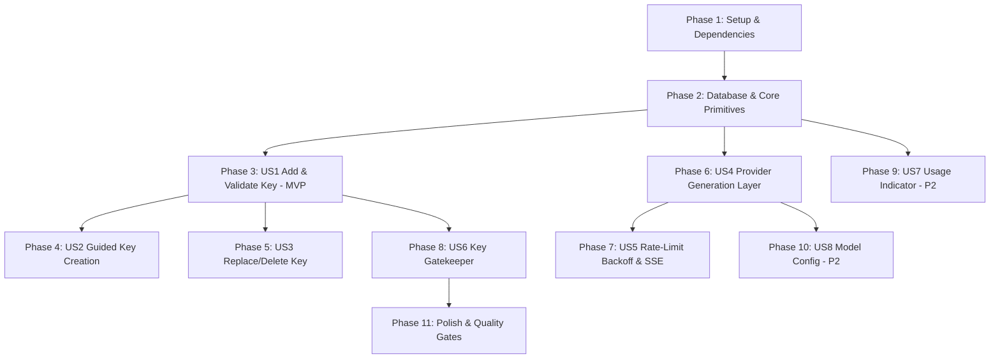

# Tasks: 004-ai-provider-keys

**Input**: Design documents from `/specs/004-ai-provider-keys/` (`spec.md`, `plan.md`, `research.md`, `data-model.md`, `contracts/`, `quickstart.md`)
**Prerequisites**: `plan.md`, `spec.md`, `research.md`, `data-model.md`
**Tests**: Derived directly from acceptance criteria in `spec.md` (Vitest for crypto, backoff, zero-leak assertions, and contract tests; Playwright for key UI and a11y audits).
**Organization**: Tasks are grouped by user story to enable independent implementation, review, and verification.

## Format: `- [ ] [ID] [P?] [Story] Description with file path`

- **[P]**: Can run in parallel (different files, no blocking dependencies on incomplete tasks)
- **[Story]**: Which user story this task belongs to (`[US1]`, `[US2]`, `[US3]`, `[US4]`, `[US5]`, `[US6]`, `[US7]`, `[US8]`)
- Every task includes an explicit file path.

---

## Phase 1: Setup (Dependencies & Configuration)

**Purpose**: Install Google GenAI SDK, configure master encryption secret, and update Pino logging redaction.

- [x] T001 Install `@google/genai` (or `@google/generative-ai`) dependency in `package.json`
- [x] T002 Add `AI_KEY_ENCRYPTION_SECRET` to environment schema and validation in `src/lib/config.ts` and `.env.example`
- [x] T003 [P] Add AI key fields (`encryptedKey`, `apiKey`, `key`, `geminiKey`, `authTag`, `nonce`) to Pino logger redaction list in `src/lib/logger.ts`

---

## Phase 2: Foundational (Database & Core AI Primitives)

**Purpose**: Database schema migrations, AES-256-GCM encryption primitives, provider abstraction interface, and fake adapter with contract tests.

**⚠️ CRITICAL**: Must be completed before user story endpoint implementation begins. Per architecture guidelines, `FakeProviderAdapter` and contract tests are built before the live `GeminiAdapter`.

- [x] T004 [P] Update Drizzle database schema with `apiKeys` and `usageCounters` tables in `src/lib/db/schema.ts`
- [x] T005 Generate and apply Drizzle database migration for `api_keys` and `usage_counters` in `src/lib/db/migrations/`
- [x] T006 [P] Implement AES-256-GCM key encryption, decryption, and last-4 masking functions in `src/lib/crypto/key-encryption.ts`
- [x] T007 [P] Create unit tests for AES-256-GCM encryption/decryption round-trip and auth tag tampering detection in `tests/unit/crypto.test.ts`
- [x] T008 [P] Define `AiProviderAdapter` interface, option types, and generation result types in `src/lib/ai/provider.ts`
- [x] T009 [P] Define normalized `AiError` domain exceptions (`InvalidApiKeyError`, `QuotaExhaustedError`, etc.) in `src/lib/ai/errors.ts`
- [x] T010 [P] Define external model configuration and default task parameters in `src/lib/ai/config.ts`
- [x] T011 [P] Implement `FakeProviderAdapter` with simulated delays, programmable errors, and mock outputs in `src/lib/ai/fake-adapter.ts`
- [x] T012 Implement provider contract tests verifying text, schema-validated JSON, and image generation using `FakeProviderAdapter` in `tests/contract/provider.contract.test.ts`
- [x] T013 Implement `GeminiAdapter` using official Google GenAI SDK conforming to `AiProviderAdapter` in `src/lib/ai/gemini.ts`

**Checkpoint**: Foundation ready — Encryption primitives, database tables, provider abstraction, fake provider, and Gemini adapter active and contract-tested.

---

## Phase 3: User Story 1 — Add and Validate Gemini API Key (Priority: P1) 🎯 MVP

**Goal**: Allow users to submit their Gemini API key, validate it via a minimal test call prior to storage, encrypt it with AES-256-GCM, and display it masked showing only the last 4 characters.

**Independent Test**: Post valid key to `/api/settings/keys` -> minimal ping verifies key, record saved encrypted in PostgreSQL, response returns masked key (`••••••••••••••Ab12`) and zero plaintext key is leaked. Post invalid key -> returns validation error and nothing is saved.

### Tests for User Story 1

- [x] T014 [P] [US1] Create unit tests asserting key masking, validation rules, and zero plaintext in logs/responses in `tests/unit/ai-keys.test.ts`

### Implementation for User Story 1

- [x] T015 [P] [US1] Define key management messages and validation strings in English, French, and Arabic in `messages/en.json`, `messages/fr.json`, and `messages/ar.json`
- [x] T016 [US1] Implement key validation and encrypted persistence API endpoint `POST /api/settings/keys` and `GET /api/settings/keys` in `src/app/api/settings/keys/route.ts`
- [x] T017 [US1] Create accessible, localized `KeySetupDialog` component with masked display and validation loading states in `src/components/keys/KeySetupDialog.tsx`
- [x] T018 [US1] Create settings key management page in `src/app/[locale]/settings/keys/page.tsx`

**Checkpoint**: User Story 1 complete — Users can securely add and validate Gemini keys with zero plaintext exposure.

---

## Phase 4: User Story 2 — Guided Key Creation & Free-Tier Notice (Priority: P1)

**Goal**: Provide an interactive visual walkthrough in English, French, and Arabic explaining how to create a free Gemini key in Google AI Studio, along with a transparent free-tier data disclaimer and mandatory consent checkbox.

**Independent Test**: Open key walkthrough in `en`, `fr`, or `ar`; confirm step-by-step instructions render with correct RTL alignment, terms link is clickable, and save button remains disabled until the consent checkbox is checked.

### Implementation for User Story 2

- [x] T019 [P] [US2] Define step-by-step walkthrough copy and provider terms disclaimer strings in `messages/en.json`, `messages/fr.json`, and `messages/ar.json`
- [x] T020 [US2] Create accessible, localized `KeyCreationGuide` walkthrough component in `src/components/keys/KeyCreationGuide.tsx`
- [x] T021 [US2] Create `FreeTierNotice` component with provider terms link and mandatory acknowledgment checkbox in `src/components/keys/FreeTierNotice.tsx`

**Checkpoint**: User Story 2 complete — Guided onboarding removes adoption friction while fulfilling privacy transparency.

---

## Phase 5: User Story 3 — Replace or Remove API Key (Priority: P1)

**Goal**: Allow users to replace an existing key (validating the new one first) or permanently delete it, and halt any in-flight runs gracefully if a key is removed.

**Independent Test**: Replace existing key -> old key replaced only if new key passes validation. Delete key -> permanently purged from DB, UI shows empty state. In-flight job with removed key halts gracefully and saves partial results.

### Tests for User Story 3

- [x] T022 [P] [US3] Create integration test for key replacement and permanent deletion in `tests/integration/key-lifecycle.test.ts`

### Implementation for User Story 3

- [x] T023 [US3] Implement key deletion endpoint `DELETE /api/settings/keys` with permanent DB purge in `src/app/api/settings/keys/route.ts`
- [x] T024 [US3] Add delete confirmation modal and key replacement flow to `src/components/keys/KeySetupDialog.tsx`
- [x] T025 [US3] Add mid-run key existence check to background worker step execution in `src/lib/ai/runner.ts`

**Checkpoint**: User Story 3 complete — User maintains full sovereignty over external credentials and quota.

---

## Phase 6: User Story 4 — Provider-Independent Generation Layer (Priority: P1)

**Goal**: Expose unified generation helper functions enforcing prompt tagged-data isolation (`<profile>`, `<brief>`) and schema validation.

**Independent Test**: Run generation pipeline using `FakeProviderAdapter`; verify prompt formatting places user content strictly inside tagged blocks as data, and output matches Zod schema.

### Tests for User Story 4

- [x] T026 [P] [US4] Create unit test for prompt tagged-data formatting and injection protection in `tests/unit/prompt.test.ts`

### Implementation for User Story 4

- [x] T027 [US4] Implement prompt tagged-data isolation helper in `src/lib/ai/prompt.ts`
- [x] T028 [US4] Implement unified generation service resolving user key and invoking provider adapter in `src/lib/ai/service.ts`

**Checkpoint**: User Story 4 complete — Agents can invoke text, structured JSON, and image generation without vendor lock-in.

---

## Phase 7: User Story 5 — Rate-Limit Backoff & Real-Time Event Reporting (Priority: P1)

**Goal**: Automatic exponential backoff with full jitter on 429 quota exhaustion (max 3 retries, up to 45s wait), reporting live countdown status over SSE.

**Independent Test**: Mock provider returning 429 twice then 200; verify backoff calculation includes jitter, retry events are emitted to the event bus, and run finishes. Mock sustained 429; verify run pauses/halts gracefully at 45s.

### Tests for User Story 5

- [x] T029 [P] [US5] Create unit tests for exponential backoff math, jitter distribution, and retry limits in `tests/unit/retry.test.ts`

### Implementation for User Story 5

- [x] T030 [US5] Implement `withRetry` wrapper with jitter and max 45s cumulative limit in `src/lib/ai/retry.ts`
- [x] T031 [US5] Connect retry events to SSE run event emitter (`agent:paused`, `reason: QUOTA_EXHAUSTED`, `retryInSeconds`) in `src/lib/ai/events.ts`

**Checkpoint**: User Story 5 complete — Transient quota limits recover automatically with full user visibility.

---

## Phase 8: User Story 6 — Gatekeeper: No Key, No Generation (Priority: P1)

**Goal**: Intercept keyless generation requests, disable the composer when no key is configured, and prompt new accounts to add a key.

**Independent Test**: Load workspace with a keyless user -> composer input is disabled with a prominent setup banner; calling `/api/generate` returns 400 `MISSING_API_KEY`.

### Implementation for User Story 6

- [x] T032 [US6] Add key presence validation check to generation route `POST /api/generate` in `src/app/api/generate/route.ts`
- [x] T033 [US6] Update composer and workspace layout with key setup banner and disabled prompt state in `src/app/[locale]/(workspace)/page.tsx`

**Checkpoint**: User Story 6 complete — BYOK model strictly enforced with clear user guidance.

---

## Phase 9: User Story 7 — Usage and Quota Indicator (Priority: P2)

**Goal**: Display recent request counts and quota error tallies for today and the last 7 days in Settings.

### Implementation for User Story 7

- [x] T034 [P] [US7] Implement daily usage counter incrementer in `src/lib/ai/usage.ts`
- [x] T035 [US7] Implement `GET /api/settings/keys/usage` endpoint in `src/app/api/settings/keys/usage/route.ts`
- [x] T036 [US7] Create accessible `UsageIndicator` chart component in `src/components/keys/UsageIndicator.tsx`

---

## Phase 10: User Story 8 — Per-Task Model Configuration (Priority: P2)

**Goal**: Allow users to select specific models for Writer, Critic, and Art Director from configured options.

### Implementation for User Story 8

- [x] T037 [P] [US8] Implement model preference selector component in `src/components/keys/ModelSelector.tsx`
- [x] T038 [US8] Add model preference storage and resolution in `src/lib/ai/config.ts`

---

## Phase 11: Polish & Quality Gates

**Purpose**: End-to-end verification, accessibility audits, and CI gate completion.

- [x] T039 Run automated accessibility audit on key setup dialog, guide, and usage chart with `@axe-core/playwright` in `tests/e2e/keys-a11y.spec.ts`
- [x] T040 Run full test suite (`pnpm test`), linter (`pnpm lint`), type checker (`pnpm type-check`), and production build (`pnpm build`) to ensure 0 errors

---

## Dependencies & Execution Order

## Parallel Execution Opportunities

- **Phase 1**: T002 and T003 can run in parallel after T001.
- **Phase 2**: T004, T006, T008, T009, T010, T011 can be authored in parallel; T012 (contract tests) runs against T011 before T013 is built.
- **Phase 3**: T014 (unit tests) and T015 (translations) can run in parallel before T016 and T017.
- **Phase 4**: T019, T020, T021 can run in parallel with Phase 5.
