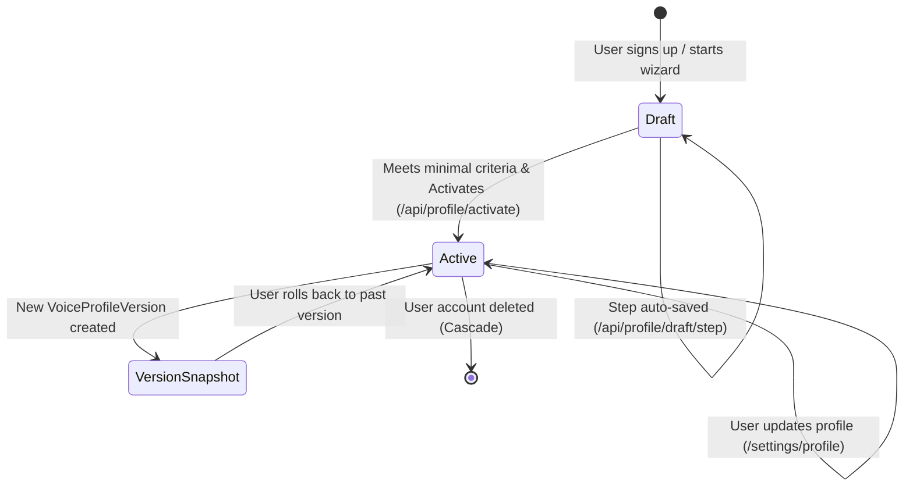

# Data Model: Voice Profile Onboarding & Management

**Feature**: `005-voice-profile`  
**Date**: 2026-10-23  
**Status**: Completed  

---

## 1. Drizzle ORM Schema (`src/lib/db/schema.ts`)

### 1.1 `profiles`
The primary anchor table holding core profile metadata, status, step progression, and typed JSON section data.

```typescript
export const profileStatusEnum = pgEnum('profile_status', ['draft', 'active']);

export const profiles = pgTable(
  'profiles',
  {
    id: uuid('id').primaryKey().defaultRandom(),
    userId: uuid('user_id')
      .notNull()
      .references(() => users.id, { onDelete: 'cascade' })
      .unique(),
    status: profileStatusEnum('status').notNull().default('draft'),
    currentStep: integer('current_step').notNull().default(1),
    currentVersion: integer('current_version').notNull().default(1),
    
    // Core identity / language fields
    primaryLanguage: varchar('primary_language', { length: 10 }).notNull().default('en'),
    arabicDialect: varchar('arabic_dialect', { length: 20 }).notNull().default('none'),
    
    // Typed JSON sections
    identityData: jsonb('identity_data').$type<{
      role: string;
      industry?: string;
      expertise?: string[];
      positioning?: string;
    }>(),
    
    principlesData: jsonb('principles_data').$type<{
      values?: string[];
      topicsToAvoid?: string[];
      toneRedLines?: string[];
    }>(),
    
    audienceData: jsonb('audience_data').$type<{
      persona?: string;
      expertiseLevel?: 'beginner' | 'intermediate' | 'expert' | 'general';
      interests?: string[];
    }>(),
    
    objectivesData: jsonb('objectives_data').$type<{
      primaryObjective?: 'authority' | 'leads' | 'hiring' | 'community' | 'sales';
      platformRankings?: Record<string, ('authority' | 'leads' | 'hiring' | 'community' | 'sales')[]>;
    }>(),
    
    styleData: jsonb('style_data').$type<{
      formality?: number; // 1 to 5
      length?: 'short' | 'medium' | 'long';
      emoji?: 'none' | 'minimal' | 'frequent';
      hookStyle?: 'bold_statement' | 'question' | 'story' | 'statistic';
    }>(),
    
    completenessScore: integer('completeness_score').notNull().default(0),
    createdAt: timestamp('created_at', { withTimezone: true }).notNull().defaultNow(),
    updatedAt: timestamp('updated_at', { withTimezone: true }).notNull().defaultNow(),
  },
  (table) => ({
    userIdIdx: index('profiles_user_id_idx').on(table.userId),
    statusIdx: index('profiles_status_idx').on(table.status),
  })
);
```

### 1.2 `voice_samples`
User-provided writing samples used by agents to calibrate linguistic style and tone.

```typescript
export const voiceSamples = pgTable(
  'voice_samples',
  {
    id: uuid('id').primaryKey().defaultRandom(),
    profileId: uuid('profile_id')
      .notNull()
      .references(() => profiles.id, { onDelete: 'cascade' }),
    title: varchar('title', { length: 255 }).notNull().default('Voice Sample'),
    content: text('content').notNull(),
    orderIndex: integer('order_index').notNull().default(0),
    createdAt: timestamp('created_at', { withTimezone: true }).notNull().defaultNow(),
    updatedAt: timestamp('updated_at', { withTimezone: true }).notNull().defaultNow(),
  },
  (table) => ({
    profileIdIdx: index('voice_samples_profile_id_idx').on(table.profileId),
  })
);
```

### 1.3 `platform_preferences`
Platform-specific objectives, configuration, and subreddit rules.

```typescript
export const platformPreferences = pgTable(
  'platform_preferences',
  {
    id: uuid('id').primaryKey().defaultRandom(),
    profileId: uuid('profile_id')
      .notNull()
      .references(() => profiles.id, { onDelete: 'cascade' }),
    platform: varchar('platform', { length: 50 }).notNull(), // 'linkedin' | 'instagram' | 'reddit' | 'x' | 'facebook'
    primaryObjective: varchar('primary_objective', { length: 50 }).notNull().default('authority'),
    subreddits: jsonb('subreddits').$type<Array<{
      name: string;
      rulesSummary?: string;
    }>>(),
    customInstructions: text('custom_instructions'),
    createdAt: timestamp('created_at', { withTimezone: true }).notNull().defaultNow(),
    updatedAt: timestamp('updated_at', { withTimezone: true }).notNull().defaultNow(),
  },
  (table) => ({
    profilePlatformUnique: uniqueIndex('profile_platform_idx').on(table.profileId, table.platform),
  })
);
```

### 1.4 `voice_profile_versions`
Audit log and snapshot repository enabling full revision history and rollback capabilities.

```typescript
export const voiceProfileVersions = pgTable(
  'voice_profile_versions',
  {
    id: uuid('id').primaryKey().defaultRandom(),
    profileId: uuid('profile_id')
      .notNull()
      .references(() => profiles.id, { onDelete: 'cascade' }),
    versionNumber: integer('version_number').notNull(),
    snapshot: jsonb('snapshot').$type<{
      identity: unknown;
      principles: unknown;
      audience: unknown;
      objectives: unknown;
      style: unknown;
      languages: { primary: string; arabicDialect: string };
      samples: Array<{ title: string; content: string; orderIndex: number }>;
      platforms: Array<{ platform: string; primaryObjective: string; subreddits?: unknown; customInstructions?: string }>;
    }>().notNull(),
    changeSummary: text('change_summary'),
    createdAt: timestamp('created_at', { withTimezone: true }).notNull().defaultNow(),
  },
  (table) => ({
    profileVersionIdx: index('voice_profile_versions_profile_idx').on(table.profileId),
    profileVersionNumUnique: uniqueIndex('voice_profile_versions_num_idx').on(table.profileId, table.versionNumber),
  })
);
```

### 1.5 `profiler_sessions`
Maintains conversational state for the AI Profiler interview mode.

```typescript
export const profilerStatusEnum = pgEnum('profiler_status', ['in_progress', 'completed', 'abandoned']);

export const profilerSessions = pgTable(
  'profiler_sessions',
  {
    id: uuid('id').primaryKey().defaultRandom(),
    userId: uuid('user_id')
      .notNull()
      .references(() => users.id, { onDelete: 'cascade' }),
    status: profilerStatusEnum('status').notNull().default('in_progress'),
    messages: jsonb('messages').$type<Array<{
      role: 'assistant' | 'user';
      content: string;
      timestamp: string;
    }>>().notNull().default([]),
    proposedProfile: jsonb('proposed_profile').$type<Record<string, unknown>>(),
    createdAt: timestamp('created_at', { withTimezone: true }).notNull().defaultNow(),
    updatedAt: timestamp('updated_at', { withTimezone: true }).notNull().defaultNow(),
  },
  (table) => ({
    userIdIdx: index('profiler_sessions_user_id_idx').on(table.userId),
  })
);
```

---

## 2. Zod Validation Schemas (`src/lib/profile/schemas.ts`)

```typescript
import { z } from 'zod';

export const IdentitySchema = z.object({
  role: z.string().min(2, 'Role is required').max(120),
  industry: z.string().max(120).optional(),
  expertise: z.array(z.string().max(80)).max(10).optional(),
  positioning: z.string().max(500).optional(),
});

export const PrinciplesSchema = z.object({
  values: z.array(z.string().max(100)).max(10).optional(),
  topicsToAvoid: z.array(z.string().max(100)).max(20).optional(),
  toneRedLines: z.array(z.string().max(100)).max(20).optional(),
});

export const AudienceSchema = z.object({
  persona: z.string().max(300).optional(),
  expertiseLevel: z.enum(['beginner', 'intermediate', 'expert', 'general']).default('general'),
  interests: z.array(z.string().max(80)).max(15).optional(),
});

export const ObjectivesSchema = z.object({
  primaryObjective: z.enum(['authority', 'leads', 'hiring', 'community', 'sales']).default('authority'),
  platformRankings: z.record(z.array(z.enum(['authority', 'leads', 'hiring', 'community', 'sales']))).optional(),
});

export const StyleSchema = z.object({
  formality: z.number().int().min(1).max(5).default(3),
  length: z.enum(['short', 'medium', 'long']).default('medium'),
  emoji: z.enum(['none', 'minimal', 'frequent']).default('minimal'),
  hookStyle: z.enum(['bold_statement', 'question', 'story', 'statistic']).default('bold_statement'),
});

export const LanguageSchema = z.object({
  primaryLanguage: z.enum(['en', 'fr', 'ar']).default('en'),
  arabicDialect: z.enum(['none', 'msa', 'darija', 'both']).default('none'),
});

export const VoiceSampleSchema = z.object({
  id: z.string().uuid().optional(),
  title: z.string().min(1).max(200).default('Voice Sample'),
  content: z.string()
    .refine((txt) => {
      const words = txt.trim().split(/\s+/).filter(Boolean).length;
      return words >= 50 && words <= 1000;
    }, { message: 'Sample must be between 50 and 1,000 words' }),
  orderIndex: z.number().int().min(0).max(4).default(0),
});

export const PlatformPreferenceSchema = z.object({
  platform: z.enum(['linkedin', 'instagram', 'reddit', 'x', 'facebook']),
  primaryObjective: z.enum(['authority', 'leads', 'hiring', 'community', 'sales']).default('authority'),
  subreddits: z.array(z.object({
    name: z.string().regex(/^r\/[a-zA-Z0-9_]{3,21}$/, 'Invalid subreddit name (e.g. r/startups)'),
    rulesSummary: z.string().max(500).optional(),
  })).optional(),
  customInstructions: z.string().max(1000).optional(),
});

// Full Profile Activation Schema (Enforces Fast-Track Minimal Completion)
export const ProfileActivationSchema = z.object({
  role: z.string().min(2, 'Role is required'),
  platforms: z.array(z.string()).min(1, 'Select at least one platform'),
  samples: z.array(VoiceSampleSchema).min(1, 'Provide at least one voice sample'),
});
```

---

## 3. Entity Relationships & State Transitions


