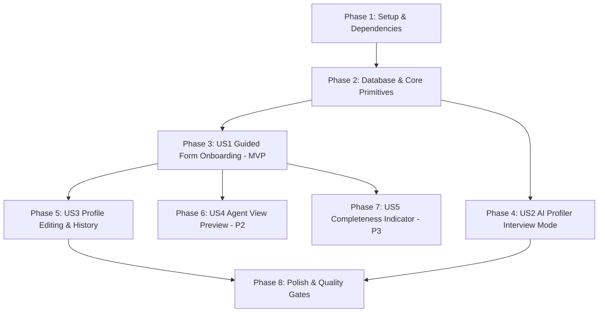

# Tasks: Voice Profile Onboarding & Management

**Input**: Design documents from `/specs/005-voice-profile/` (`spec.md`, `plan.md`, `research.md`, `data-model.md`, `contracts/`, `quickstart.md`)  
**Prerequisites**: `plan.md`, `spec.md`, `research.md`, `data-model.md`  
**Tests**: Derived directly from acceptance criteria in `spec.md` (Vitest snapshot tests for summary builder, integration tests for draft autosave & multi-turn profiler with `FakeProviderAdapter`, and Playwright E2E tests in English, French, and Arabic).  
**Organization**: Tasks are grouped by user story to enable independent implementation, review, and verification.

## Format: `- [ ] [ID] [P?] [Story] Description with file path`

- **[P]**: Can run in parallel (different files, no blocking dependencies on incomplete tasks)
- **[Story]**: Which user story this task belongs to (`[US1]`, `[US2]`, `[US3]`, `[US4]`, `[US5]`)
- Every task includes an explicit file path.

---

## Phase 1: Setup (Dependencies & Translations)

**Purpose**: Install form handling dependencies and configure multilingual dictionaries for onboarding and profile management.

- [x] T001 Install `react-hook-form` and `@hookform/resolvers` dependencies in `package.json`
- [x] T002 [P] Add English translations for onboarding, steps, and profile management in `messages/en.json`
- [x] T003 [P] Add French translations for onboarding, steps, and profile management in `messages/fr.json`
- [x] T004 [P] Add Arabic translations for onboarding, steps, and profile management in `messages/ar.json`

---

## Phase 2: Foundational (Database & Core Profile Primitives)

**Purpose**: Database schema migrations, Zod schemas, pure versioned prompt summary builder, and completeness scoring.

**⚠️ CRITICAL**: Must be completed before user story endpoints and UI are implemented.

- [x] T005 [P] Update Drizzle database schema with `profiles`, `voice_samples`, `platform_preferences`, `voice_profile_versions`, and `profiler_sessions` tables in `src/lib/db/schema.ts`
- [x] T006 Generate and apply Drizzle database migration for voice profile tables in `src/lib/db/migrations/`
- [x] T007 [P] Implement comprehensive Zod validation schemas for profile sections, samples (50–1,000 words), subreddits, and activation in `src/lib/profile/schemas.ts`
- [x] T008 [P] Create unit tests verifying Zod schemas, boundary validations, and activation criteria in `tests/unit/profile-schemas.test.ts`
- [x] T009 [P] Implement pure, versioned `buildVoiceProfileSummary` function with XML delimiter escaping in `src/lib/profile/summary-builder.ts`
- [x] T010 [P] Create snapshot tests for `buildVoiceProfileSummary` verifying deterministic output and delimiter escaping in `tests/unit/profile-summary.test.ts`
- [x] T011 [P] Implement profile completeness scoring algorithm (0–100%) with actionable tips in `src/lib/profile/completeness.ts`
- [x] T012 [P] Create unit tests for completeness scoring logic in `tests/unit/completeness.test.ts`

**Checkpoint**: Foundation ready — Database tables, validation schemas, prompt builder, and completeness score active and tested.

---

## Phase 3: User Story 1 — Guided Form Onboarding & Stepwise Progress (Priority: P1) 🎯 MVP

**Goal**: Allow professionals to complete a 7-step guided setup flow with auto-saved drafts and fast-track activation (Role, ≥1 platform, ≥1 voice sample required).

**Independent Test**: Complete 7 steps, close browser mid-way on Step 4, return to find Step 4 restored with previous inputs intact, complete required fields, and activate profile.

### Tests for User Story 1

- [x] T013 [P] [US1] Create integration tests for multi-step draft autosave, step progression, and fast-track activation in `tests/integration/profile-draft.test.ts`

### Implementation for User Story 1

- [x] T014 [US1] Implement draft retrieval endpoint `GET /api/profile/draft` in `src/app/api/profile/draft/route.ts`
- [x] T015 [US1] Implement step-level persistence endpoint `POST /api/profile/draft/step` in `src/app/api/profile/draft/step/route.ts`
- [x] T016 [US1] Implement profile activation endpoint `POST /api/profile/activate` in `src/app/api/profile/activate/route.ts`
- [x] T017 [P] [US1] Create accessible, RTL-aware step progress indicator component in `src/components/profile/StepIndicator.tsx`
- [x] T018 [P] [US1] Create Step 1 (Identity) form component in `src/components/profile/steps/Step1Identity.tsx`
- [x] T019 [P] [US1] Create Step 2 (Principles) form component in `src/components/profile/steps/Step2Principles.tsx`
- [x] T020 [P] [US1] Create Step 3 (Audience) form component in `src/components/profile/steps/Step3Audience.tsx`
- [x] T021 [P] [US1] Create Step 4 (Objectives) form component in `src/components/profile/steps/Step4Objectives.tsx`
- [x] T022 [P] [US1] Create Step 5 (Style & Languages with Arabic dialect) form component in `src/components/profile/steps/Step5StyleLanguage.tsx`
- [x] T023 [P] [US1] Create Step 6 (Voice Samples with word counter) form component in `src/components/profile/steps/Step6VoiceSamples.tsx`
- [x] T024 [P] [US1] Create Step 7 (Platforms & Reddit rules) form component in `src/components/profile/steps/Step7Platforms.tsx`
- [x] T025 [US1] Implement `OnboardingWizard` orchestrator with React Hook Form and debounced draft autosave in `src/components/profile/OnboardingWizard.tsx`
- [x] T026 [US1] Create onboarding page container in `src/app/[locale]/onboarding/page.tsx`
- [x] T027 [US1] Update workspace gatekeeper in `src/app/[locale]/page.tsx` to redirect users without an active profile to `/onboarding`

**Checkpoint**: User Story 1 complete — Users can complete the guided flow with autosave and activate their voice profile.

---

## Phase 4: User Story 2 — Conversational AI Profiler Interview Mode (Priority: P1)

**Goal**: Provide an AI-powered conversational interview alternative asking ~10 sequential questions, following up on vague answers, pausing cleanly on quota issues, and proposing a structured profile requiring user confirmation.

**Independent Test**: Launch AI Profiler interview, answer questions conversationally, test that brief answers trigger follow-ups, simulate quota pause and resumption, and confirm proposal commits active profile.

### Tests for User Story 2

- [x] T028 [P] [US2] Create integration tests for AI Profiler interview flow, smart follow-ups, and schema-validated synthesis in `tests/integration/profiler-agent.test.ts`

### Implementation for User Story 2

- [x] T029 [US2] Implement AI Profiler agent interview prompts and synthesis logic using `generateUserText` and `generateUserStructured` in `src/lib/profile/profiler-agent.ts`
- [x] T030 [US2] Implement interview chat SSE endpoint `POST /api/profile/profiler/chat` in `src/app/api/profile/profiler/chat/route.ts`
- [x] T031 [US2] Implement proposal confirmation endpoint `POST /api/profile/profiler/confirm` in `src/app/api/profile/profiler/confirm/route.ts`
- [x] T032 [US2] Create conversational chat UI with aria-live updates and key error recovery overlay in `src/components/profile/ProfilerChat.tsx`
- [x] T033 [US2] Create structured proposal review modal with "Accept & Save" and "Edit before saving" in `src/components/profile/ProfilerProposalModal.tsx`
- [x] T034 [US2] Integrate AI Profiler mode switcher into `src/app/[locale]/onboarding/page.tsx`

**Checkpoint**: User Story 2 complete — Users can be interviewed conversationally and synthesize a verified voice profile.

---

## Phase 5: User Story 3 — Voice Profile Editing & Dashboard Management (Priority: P1)

**Goal**: Allow users to edit any section of their active profile at `/settings/profile`, create versioned snapshots, view revision history, and roll back to previous profiles.

**Independent Test**: Edit principles and platforms in Settings, save changes, inspect revision history to verify version increment, and trigger a rollback to restore previous state.

### Tests for User Story 3

- [x] T035 [P] [US3] Create integration tests for profile mutations, immutable version snapshot creation, and rollback restoration in `tests/integration/profile-lifecycle.test.ts`

### Implementation for User Story 3

- [x] T036 [US3] Implement active profile fetch and update endpoints `GET /api/profile` and `PUT /api/profile` in `src/app/api/profile/route.ts`
- [x] T037 [US3] Implement version history and rollback endpoints `GET /api/profile/versions` and `POST /api/profile/versions/[versionNumber]/rollback` in `src/app/api/profile/versions/route.ts` and `src/app/api/profile/versions/[versionNumber]/rollback/route.ts`
- [x] T038 [US3] Create revision history list component with diff view and rollback action in `src/components/profile/RevisionHistoryList.tsx`
- [x] T039 [US3] Create settings profile management page in `src/app/[locale]/settings/profile/page.tsx`

**Checkpoint**: User Story 3 complete — Users have full editing control and versioned safety for their voice profile.

---

## Phase 6: User Story 4 — Read-Only Agent Prompt Profile Preview (Priority: P2)

**Goal**: Provide a read-only "Agent View" displaying the exact delimited prompt markdown injected into autonomous generation agents.

**Independent Test**: Open the Agent View tab on `/settings/profile` and verify that user identity, values, style, platforms, and samples appear inside sanitized `<voice_profile>` blocks.

### Implementation for User Story 4

- [x] T040 [US4] Implement agent preview endpoint `GET /api/profile/preview` in `src/app/api/profile/preview/route.ts`
- [x] T041 [US4] Create `AgentPromptPreview` modal/tab component in `src/components/profile/AgentPromptPreview.tsx`
- [x] T042 [US4] Embed Agent View tab in `src/app/[locale]/settings/profile/page.tsx`

---

## Phase 7: User Story 5 — Voice Profile Completeness Indicator (Priority: P3)

**Goal**: Display a visual completeness meter (0–100%) with actionable tips to encourage users to add optional fidelity.

### Implementation for User Story 5

- [x] T043 [P] [US5] Create `CompletenessMeter` badge and progress bar component in `src/components/profile/CompletenessMeter.tsx`
- [x] T044 [US5] Embed completeness indicator in `src/components/profile/OnboardingWizard.tsx` and `src/app/[locale]/settings/profile/page.tsx`

---

## Phase 8: Polish & Quality Gates

**Purpose**: Multilingual end-to-end verification, accessibility audits, and CI gate checks.

- [x] T045 [P] Implement automated Playwright E2E tests for onboarding wizard in English, French, and Arabic (RTL) in `tests/e2e/onboarding-i18n.spec.ts`
- [x] T046 [P] Implement automated accessibility audit for onboarding wizard and settings profile with `@axe-core/playwright` in `tests/e2e/profile-a11y.spec.ts`
- [x] T047 Run full test suite (`pnpm test`), linter (`pnpm lint`), type checker (`pnpm type-check`), and production build (`pnpm build`) to ensure 0 errors

---

## Dependencies & Execution Order

## Parallel Execution Opportunities

- **Phase 1**: T002, T003, T004 (translations for EN, FR, AR) can run in parallel after T001.
- **Phase 2**: T007, T009, T011 can be authored in parallel; T008, T010, T012 unit tests run alongside them.
- **Phase 3**: Step UI components (T018 to T024) can be developed in parallel before T025 coordinator is wired.
- **Phase 8**: T045 and T046 (Playwright E2E & a11y specs) can run in parallel before T047 final build verification.
