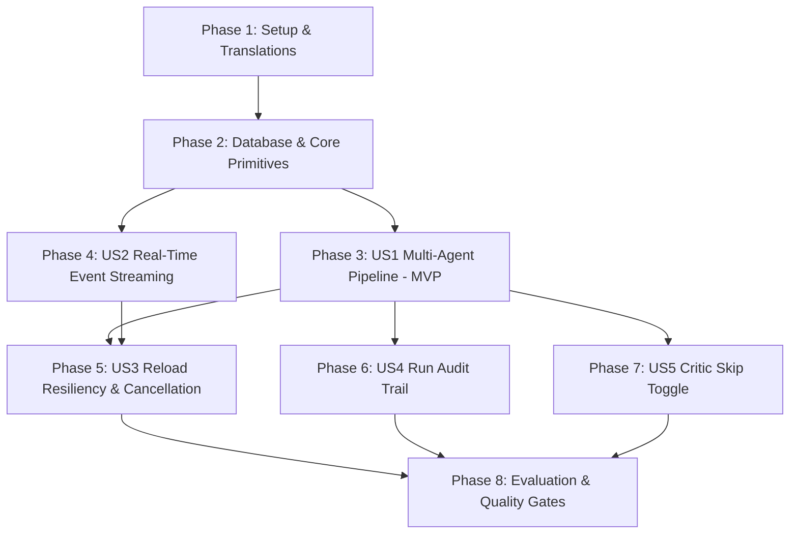

# Tasks: 006 — Agent Engine & Live Activity

**Input**: Design documents from `/specs/006-agent-engine/` (`spec.md`, `plan.md`, `research.md`, `data-model.md`, `contracts/`, `quickstart.md`)  
**Prerequisites**: `plan.md`, `spec.md`, `research.md`, `data-model.md`, `contracts/`  
**Tests**: Derived directly from acceptance criteria in `spec.md` (contract tests for Redis streams & SSE, integration pipeline tests with `FakeAiProviderAdapter`, golden-profile evaluation suite, and adversarial prompt-injection tests).  
**Organization**: Tasks are grouped by user story to enable independent implementation, review, and verification.

## Format: `- [ ] [ID] [P?] [Story] Description with file path`

- **[P]**: Can run in parallel (different files, no blocking dependencies on incomplete tasks)
- **[Story]**: Which user story this task belongs to (`[US1]`, `[US2]`, `[US3]`, `[US4]`, `[US5]`)
- Every task includes an explicit file path.

---

## Phase 1: Setup & Translations

**Purpose**: Add internationalized dictionary keys for agent activities, statuses, hand-off reasons, and pipeline controls.

- [x] T001 [P] Add English translations for Agent Engine (activity timeline, agent statuses, hand-off labels, cancel, fast draft) in `messages/en.json`
- [x] T002 [P] Add French translations for Agent Engine in `messages/fr.json`
- [x] T003 [P] Add Arabic translations for Agent Engine in `messages/ar.json`

---

## Phase 2: Foundational (Database & Core Agent Engine Primitives)

**Purpose**: Database schema migrations, versioned prompt templates, Zod schemas, pure prompt builder, and platform rules.

**⚠️ CRITICAL**: Must be completed before pipeline orchestrator and endpoints are implemented.

- [x] T004 [P] Update Drizzle database schema with `runs` and `agent_steps` tables in `src/lib/db/schema.ts`
- [x] T005 Generate and apply Drizzle database migration for `runs` and `agent_steps` in `src/lib/db/migrations/`
- [x] T006 [P] Create versioned role prompt template for Writer in `src/lib/agent-engine/prompts/writer.v1.md`
- [x] T007 [P] Create versioned role prompt template for Critic in `src/lib/agent-engine/prompts/critic.v1.md`
- [x] T008 [P] Create versioned role prompt template for Art Director in `src/lib/agent-engine/prompts/art-director.v1.md`
- [x] T009 [P] Implement platform formatting guidelines and community norms configuration in `src/lib/agent-engine/platform-rules.ts`
- [x] T010 [P] Implement Zod validation schemas for Writer, Critic, and Art Director structured outputs with placeholder checks in `src/lib/agent-engine/schemas.ts`
- [x] T011 [P] Create unit tests for Zod output schemas and validation retry helpers in `tests/unit/agent-engine-schemas.test.ts`
- [x] T012 [P] Implement pure 5-layer prompt assembler with XML delimiter tags and entity escaping in `src/lib/agent-engine/prompt-builder.ts`
- [x] T013 [P] Create unit tests for prompt assembler verifying layer stacking and XML sanitization in `tests/unit/agent-engine-prompts.test.ts`

**Checkpoint**: Foundation ready — Schemas, migrations, versioned prompt files, and pure prompt builder active and tested.

---

## Phase 3: User Story 1 — Deterministic Multi-Agent Generation Pipeline (Priority: P1) 🎯 MVP

**Goal**: Execute a fixed pipeline (Writer → Critic → optional Revision → Art Director) producing platform-native posts with zero invented facts and XML data isolation.

**Independent Test**: Trigger a generation run with brief "Launched our new observability agent" for LinkedIn and Reddit; verify Writer drafts both in 1 call, Critic scores 6 dimensions, Writer executes at most 1 revision, Art Director generates image prompt + alt text, and structured posts are produced without invented facts.

### Tests for User Story 1

- [x] T014 [P] [US1] Create integration test for deterministic pipeline execution with `FakeAiProviderAdapter` validating 1-call multi-platform drafting, scoring, and bounded 1-loop revision in `tests/integration/agent-pipeline.test.ts`

### Implementation for User Story 1

- [x] T015 [US1] Implement Writer agent caller function using `generateUserStructured` and `WriterOutputSchema` in `src/lib/agent-engine/agents/writer.ts`
- [x] T016 [US1] Implement Critic agent caller function evaluating 6 dimensions and returning verdict in `src/lib/agent-engine/agents/critic.ts`
- [x] T017 [US1] Implement Art Director agent caller function creating image prompt and alt text in `src/lib/agent-engine/agents/art-director.ts`
- [x] T018 [US1] Implement core pipeline state machine orchestrator in `src/lib/agent-engine/orchestrator.ts`
- [x] T019 [US1] Implement post generation creation endpoint `POST /api/runs` in `src/app/api/runs/route.ts`
- [x] T020 [US1] Implement run details and post retrieval endpoint `GET /api/runs/[runId]` in `src/app/api/runs/[runId]/route.ts`

**Checkpoint**: User Story 1 complete — Deterministic pipeline executes end-to-end and returns schema-validated multi-platform posts.

---

## Phase 4: User Story 2 — Real-Time Live Activity & Event Streaming (Priority: P1)

**Goal**: Stream fine-grained lifecycle events via Redis Streams and SSE with automatic reconnection from `Last-Event-ID`, displaying agent badges, status lines, hand-offs with revision rationale, and pause countdowns.

**Independent Test**: Connect to SSE route `GET /api/runs/[runId]/events` during a run; verify receiving ordered events (`run.started`, `agent.started`, `agent.progress`, `agent.handoff`, `agent.completed`, `run.completed`), disconnect and reconnect with `Last-Event-ID` to verify complete event replay without duplicates.

### Tests for User Story 2

- [x] T021 [P] [US2] Create contract tests for Redis stream event encoding and SSE event payloads in `tests/contract/agent-events.contract.test.ts`
- [x] T022 [P] [US2] Create integration test for SSE route verifying `Last-Event-ID` recovery and stream resumption in `tests/integration/sse-streaming.test.ts`

### Implementation for User Story 2

- [x] T023 [US2] Implement Redis Stream publisher (`XADD`) and range reader (`XRANGE` / `XREAD`) in `src/lib/agent-engine/event-stream.ts`
- [x] T024 [US2] Implement Server-Sent Events route `GET /api/runs/[runId]/events` with `Last-Event-ID` recovery and `X-Accel-Buffering: no` in `src/app/api/runs/[runId]/events/route.ts`
- [x] T025 [US2] Create client-side React hook `useRunEvents` managing SSE connection, auto-reconnect, and state accumulation in `src/hooks/useRunEvents.ts`
- [x] T026 [US2] Update `ActivityTimeline` component to consume real-time events, animating hand-off transitions with plain-language reasons in `src/components/agent/ActivityTimeline.tsx`
- [x] T027 [US2] Update `AgentChip` component to show active agent name, one-line status (< 12 words), and rate-limit countdown timers in `src/components/agent/AgentChip.tsx`

**Checkpoint**: User Story 2 complete — Users experience real-time visibility into agent activities with resilient SSE streaming.

---

## Phase 5: User Story 3 — Reload Resiliency & Run Cancellation (Priority: P1)

**Goal**: Execute generation in BullMQ background queue so runs survive browser reloads, and allow users to cancel active runs immediately halting downstream model calls.

**Independent Test**: Start a generation run, reload the page midway through the Critic step, verify run rehydrates and continues streaming to completion. Trigger cancel and verify immediate cancellation within 1.5 seconds.

### Tests for User Story 3

- [x] T028 [P] [US3] Create integration test verifying BullMQ worker job execution, state rehydration across disconnections, and cancellation signal handling in `tests/integration/run-resiliency.test.ts`

### Implementation for User Story 3

- [x] T029 [US3] Implement BullMQ job processor for `generate-post-run` in `src/worker/processors/agent-engine.ts`
- [x] T030 [US3] Register agent engine processor with BullMQ worker in `src/lib/queue/worker.ts` and `src/worker/index.ts`
- [x] T031 [US3] Implement run cancellation endpoint `POST /api/runs/[runId]/cancel` setting Redis abort signal in `src/app/api/runs/[runId]/cancel/route.ts`
- [x] T032 [US3] Wire Workspace Composer and Activity Timeline in `src/app/[locale]/page.tsx` to rehydrate active runs on mount and support Cancel Run action

**Checkpoint**: User Story 3 complete — Runs survive page refreshes and can be cancelled on demand.

---

## Phase 6: User Story 4 — Run Audit Trail & Step History (Priority: P1)

**Goal**: Persist every run and intermediate agent step with agent ID, task name, model, prompt template version, execution duration, and error codes without leaking credentials or raw prompt text into logs.

**Independent Test**: Complete a generation run and inspect `runs` and `agent_steps` rows; verify prompt version and durations are recorded and check server logs to confirm zero secret leakage.

### Tests for User Story 4

- [x] T033 [P] [US4] Create unit test verifying logger redaction and step persistence in `tests/unit/run-audit-trail.test.ts`

### Implementation for User Story 4

- [x] T034 [US4] Implement `recordAgentStep` helper to record granular step metrics and durations in `src/lib/agent-engine/audit.ts`
- [x] T035 [US4] Hook audit logging into orchestrator state transitions in `src/lib/agent-engine/orchestrator.ts`

**Checkpoint**: User Story 4 complete — Complete audit trail recorded with zero credential leakage.

---

## Phase 7: User Story 5 — Critic Skip Toggle Option (Priority: P2)

**Goal**: Allow users to optionally skip the Critic step (`skipCritic: true`), reducing pipeline execution to Writer followed immediately by Art Director in 2 model calls.

**Independent Test**: Submit a run with `skipCritic: true`; verify the pipeline executes Writer and Art Director only, omitting Critic, completing in 2 model calls, and labeling post cards as "Fast Draft (Uncritiqued)".

### Tests for User Story 5

- [x] T036 [P] [US5] Create unit test verifying orchestrator transitions from Writer directly to Art Director when `skipCritic: true` in `tests/unit/critic-skip.test.ts`

### Implementation for User Story 5

- [x] T037 [US5] Add `skipCritic` branching logic to orchestrator state machine in `src/lib/agent-engine/orchestrator.ts`
- [x] T038 [US5] Add "Fast Draft (Skip Critic)" toggle to Composer options in `src/components/layout/Composer.tsx`

**Checkpoint**: User Story 5 complete — Fast draft option active and tested.

---

## Phase 8: Polish, Golden-Profile Evaluation & Quality Gates

**Purpose**: Evaluation against golden profiles, prompt-injection defense verification, and final CI quality gates.

- [ ] T039 [P] Create 5 canonical golden profiles and briefs (English, French, Arabic MSA, Algerian Darija, Creative) in `tests/evaluation/golden-profiles.ts`
- [ ] T040 [P] Implement golden-profile evaluation test suite running against `FakeAiProviderAdapter` in CI and live API on demand in `tests/evaluation/agent-engine-eval.test.ts`
- [ ] T041 [P] Implement adversarial security test suite testing 10 prompt injection payloads in `tests/security/prompt-injection.test.ts`
- [ ] T042 [P] Implement Playwright E2E test verifying live SSE activity streaming, timeline rendering, and reload survival in `tests/e2e/agent-activity-stream.spec.ts`
- [ ] T043 Run full test suite (`pnpm test`), linter (`pnpm lint`), type checker (`pnpm type-check`), and production build (`pnpm build`) to ensure 0 errors

---

## Dependencies & Execution Order

## Parallel Execution Opportunities

- **Phase 1**: T001, T002, T003 (EN, FR, AR translations) can execute in parallel.
- **Phase 2**: Prompt files (T006, T007, T008) and Schemas/Rules (T009, T010, T012) can be created in parallel; unit tests T011 and T013 run concurrently.
- **Phase 3**: Agents (T015, T016, T017) can be developed in parallel before T018 orchestrator wires them together.
- **Phase 4**: Event contract test (T021) and SSE test (T022) run in parallel with component updates (T026, T027).
- **Phase 8**: Evaluation suite (T040), Security tests (T041), and E2E spec (T042) can run in parallel before final build gate T043.
