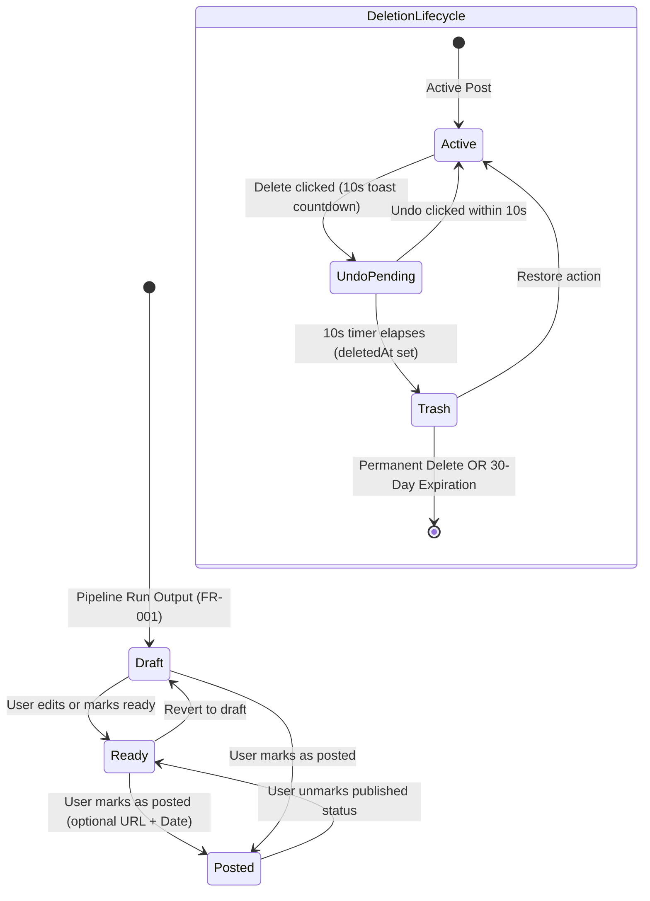

# Data Model & Schema Design: 007 — Post Library

**Date**: 2026-10-23  
**Status**: Ready  
**Feature Spec**: [specs/007-post-library/spec.md](file:///c:/Users/Ramzi/.gemini/antigravity/scratch/Saouti/specs/007-post-library/spec.md)

---

## 1. Drizzle ORM Entity Definitions

```typescript
import {
  pgTable,
  uuid,
  varchar,
  timestamp,
  text,
  integer,
  jsonb,
  index,
  uniqueIndex,
  primaryKey,
  customType,
} from 'drizzle-orm/pg-core';
import { sql, type InferSelectModel, type InferInsertModel } from 'drizzle-orm';
import { users } from './schema';
import { runs } from './schema';

/**
 * Custom tsvector type for PostgreSQL full-text search
 */
const tsvector = customType<{ data: string }>({
  dataType() {
    return 'tsvector';
  },
});

/**
 * Posts Table
 * Represents a platform-specific social post in the user's library.
 */
export const posts = pgTable(
  'posts',
  {
    id: uuid('id')
      .primaryKey()
      .default(sql`gen_random_uuid()`),
    userId: uuid('user_id')
      .notNull()
      .references(() => users.id, { onDelete: 'cascade' }),
    runId: uuid('run_id').references(() => runs.id, { onDelete: 'set null' }),
    platform: varchar('platform', { length: 50 }).notNull(), // 'linkedin' | 'x' | 'reddit' | 'instagram' | 'facebook'
    language: varchar('language', { length: 10 }).notNull().default('en'),
    status: varchar('status', { length: 20 }).notNull().default('draft'), // 'draft' | 'ready' | 'posted'
    content: text('content').notNull(),
    hashtags: jsonb('hashtags').$type<string[]>().notNull().default([]),
    imagePrompt: text('image_prompt'),
    imageAltText: text('image_alt_text'),
    imageAspectRatio: varchar('image_aspect_ratio', { length: 20 }),
    publishedUrl: text('published_url'),
    publishedAt: timestamp('published_at', { withTimezone: true }),
    deletedAt: timestamp('deleted_at', { withTimezone: true }), // Nullable: set when moved to 30-day trash
    searchVector: tsvector('search_vector'), // Generated tsvector column backed by GIN index
    createdAt: timestamp('created_at', { withTimezone: true })
      .defaultNow()
      .notNull(),
    updatedAt: timestamp('updated_at', { withTimezone: true })
      .defaultNow()
      .notNull(),
  },
  (table) => [
    index('posts_user_status_created_idx').on(
      table.userId,
      table.deletedAt,
      table.createdAt,
    ),
    index('posts_user_platform_idx').on(table.userId, table.platform),
    index('posts_run_id_idx').on(table.runId),
  ],
);

export type Post = InferSelectModel<typeof posts>;
export type NewPost = InferInsertModel<typeof posts>;

/**
 * Post Versions Table
 * Immutable snapshots capturing post history up to 20 versions per post.
 */
export const postVersions = pgTable(
  'post_versions',
  {
    id: uuid('id')
      .primaryKey()
      .default(sql`gen_random_uuid()`),
    postId: uuid('postId')
      .notNull()
      .references(() => posts.id, { onDelete: 'cascade' }),
    versionNumber: integer('version_number').notNull(),
    content: text('content').notNull(),
    hashtags: jsonb('hashtags').$type<string[]>().notNull().default([]),
    imagePrompt: text('image_prompt'),
    changeSummary: text('change_summary'),
    createdAt: timestamp('created_at', { withTimezone: true })
      .defaultNow()
      .notNull(),
  },
  (table) => [
    uniqueIndex('post_version_num_idx').on(table.postId, table.versionNumber),
    index('post_versions_post_id_idx').on(table.postId),
  ],
);

export type PostVersion = InferSelectModel<typeof postVersions>;
export type NewPostVersion = InferInsertModel<typeof postVersions>;

/**
 * Tags Table
 * User-created freeform categorization tags.
 */
export const tags = pgTable(
  'tags',
  {
    id: uuid('id')
      .primaryKey()
      .default(sql`gen_random_uuid()`),
    userId: uuid('user_id')
      .notNull()
      .references(() => users.id, { onDelete: 'cascade' }),
    name: varchar('name', { length: 30 }).notNull(),
    color: varchar('color', { length: 30 }).notNull().default('#6366f1'),
    createdAt: timestamp('created_at', { withTimezone: true })
      .defaultNow()
      .notNull(),
  },
  (table) => [
    uniqueIndex('tags_user_name_idx').on(table.userId, table.name),
  ],
);

export type Tag = InferSelectModel<typeof tags>;
export type NewTag = InferInsertModel<typeof tags>;

/**
 * Post Tags Associative Table
 * Links posts with up to 5 tags.
 */
export const postTags = pgTable(
  'post_tags',
  {
    postId: uuid('post_id')
      .notNull()
      .references(() => posts.id, { onDelete: 'cascade' }),
    tagId: uuid('tag_id')
      .notNull()
      .references(() => tags.id, { onDelete: 'cascade' }),
    createdAt: timestamp('created_at', { withTimezone: true })
      .defaultNow()
      .notNull(),
  },
  (table) => [
    primaryKey({ columns: [table.postId, table.tagId] }),
    index('post_tags_tag_id_idx').on(table.tagId),
  ],
);

export type PostTag = InferSelectModel<typeof postTags>;
export type NewPostTag = InferInsertModel<typeof postTags>;
```

---

## 2. PostgreSQL Full-Text Search Migration DDL

```sql
-- Migration snippet for Generated TSVector and GIN Index

-- 1. Arabic text normalization function
CREATE OR REPLACE FUNCTION normalize_arabic(text_val text) 
RETURNS text AS $$
BEGIN
  IF text_val IS NULL THEN
    RETURN '';
  END IF;
  -- Normalize Alef variants
  text_val := regexp_replace(text_val, '[أإآ]', 'ا', 'g');
  -- Normalize Taa Marbuta
  text_val := regexp_replace(text_val, 'ة', 'ه', 'g');
  -- Normalize Alef Maqsura
  text_val := regexp_replace(text_val, 'ى', 'ي', 'g');
  -- Strip Tashkeel (harakat)
  text_val := regexp_replace(text_val, '[\u064B-\u0652]', '', 'g');
  -- Strip Tatweel (kashida)
  text_val := regexp_replace(text_val, '\u0640', '', 'g');
  RETURN text_val;
END;
$$ LANGUAGE plpgsql IMMUTABLE;

-- 2. Add generated search vector column on posts
ALTER TABLE posts ADD COLUMN IF NOT EXISTS search_vector tsvector GENERATED ALWAYS AS (
  setweight(to_tsvector('simple', normalize_arabic(coalesce(content, ''))), 'A') ||
  setweight(to_tsvector('simple', coalesce(content, '')), 'A') ||
  setweight(to_tsvector('english', coalesce(content, '')), 'B') ||
  setweight(to_tsvector('french', coalesce(content, '')), 'C')
) STORED;

-- 3. GIN index for rapid full-text retrieval
CREATE INDEX IF NOT EXISTS posts_search_vector_idx ON posts USING GIN (search_vector);
```

---

## 3. Zod Validation Schemas

```typescript
import { z } from 'zod';

export const PlatformSchema = z.enum([
  'linkedin',
  'x',
  'reddit',
  'instagram',
  'facebook',
]);

export const PostStatusSchema = z.enum(['draft', 'ready', 'posted']);

export const UpdatePostSchema = z.object({
  content: z.string().min(1, 'Content cannot be empty'),
  hashtags: z.array(z.string().regex(/^#?[a-zA-Z0-9_\u0600-\u06FF]+$/)).max(30).default([]),
  imagePrompt: z.string().max(2000).optional(),
  imageAltText: z.string().max(1000).optional(),
  status: PostStatusSchema.optional(),
  changeSummary: z.string().max(255).optional(),
});

export const MarkAsPostedSchema = z.object({
  publishedUrl: z
    .string()
    .url('Must be a valid URL')
    .startsWith('https://', 'URL must use HTTPS protocol')
    .optional()
    .or(z.literal('')),
  publishedAt: z.string().datetime().optional(),
});

export const TagInputSchema = z.object({
  name: z
    .string()
    .min(1, 'Tag name required')
    .max(30, 'Tag name must be 30 characters or fewer')
    .transform((val) => val.trim()),
  color: z
    .string()
    .regex(/^#[0-9a-fA-F]{6}$/, 'Must be a 6-digit hex color code')
    .default('#6366f1'),
});

export const PostFilterQuerySchema = z.object({
  platform: PlatformSchema.optional(),
  status: PostStatusSchema.optional(),
  tag: z.string().optional(),
  search: z.string().max(200).optional(),
  dateFrom: z.string().datetime().optional(),
  dateTo: z.string().datetime().optional(),
  isTrash: z
    .enum(['true', 'false'])
    .optional()
    .transform((val) => val === 'true'),
  cursor: z.string().optional(),
  limit: z.coerce.number().int().min(1).max(100).default(20),
});
```

---

## 4. Entity Lifecycle & State Transitions


