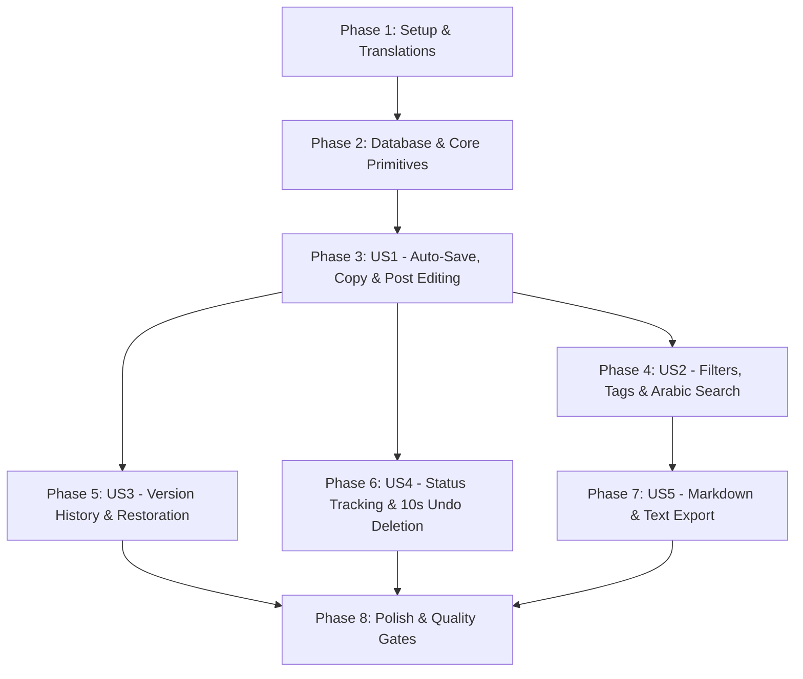

# Tasks: 007 — Post Library

**Input**: Design documents from `/specs/007-post-library/` (`spec.md`, `plan.md`, `research.md`, `data-model.md`, `contracts/`, `quickstart.md`)  
**Prerequisites**: `plan.md`, `spec.md`, `research.md`, `data-model.md`, `contracts/`  
**Tests**: Derived directly from acceptance criteria in `spec.md` (unit tests for normalizers & formatters, database integration tests for filters, search, versioning, and trash lifecycle, and Playwright E2E tests for copy & mark-as-posted).  
**Organization**: Tasks are grouped by user story to enable independent implementation, review, and verification.

## Format: `- [ ] [ID] [P?] [Story] Description with file path`

- **[P]**: Can run in parallel (different files, no blocking dependencies on incomplete tasks)
- **[Story]**: Which user story this task belongs to (`[US1]`, `[US2]`, `[US3]`, `[US4]`, `[US5]`)
- Every task includes an explicit file path.

---

## Phase 1: Setup & Translations

**Purpose**: Add internationalized dictionary keys for post library features, statuses, filter labels, actions, undo toasts, and export dialogs.

- [x] T001 [P] Add English translations for Post Library (card actions, filter labels, search placeholder, copy feedback, versions, undo toast, trash bin, export) in `messages/en.json`
- [x] T002 [P] Add French translations for Post Library in `messages/fr.json`
- [x] T003 [P] Add Arabic translations for Post Library with RTL terms in `messages/ar.json`

---

## Phase 2: Foundational (Database & Core Primitives)

**Purpose**: Database schema migrations, full-text search functions, Arabic normalizer, and resilient clipboard utility.

**⚠️ CRITICAL**: Must be completed before API endpoints and UI components are implemented.

- [x] T004 [P] Update Drizzle database schema with `posts`, `post_versions`, `tags`, and `post_tags` tables in `src/lib/db/schema.ts`
- [x] T005 Generate and apply Drizzle database migration for `posts`, `post_versions`, `tags`, `post_tags`, Arabic normalization function `normalize_arabic`, and `search_vector` GIN index in `src/lib/db/migrations/`
- [x] T006 [P] Implement pure Arabic text normalization utility `normalizeArabicText` (handling Alef variants, Taa Marbuta, and Tashkeel stripping) in `src/lib/search/arabic-normalizer.ts`
- [x] T007 [P] Create unit tests for Arabic text normalization covering Alef forms, Taa Marbuta, and Tashkeel stripping in `tests/unit/arabic-normalizer.test.ts`
- [x] T008 [P] Implement resilient clipboard utility `copyToClipboard` with `<textarea>` fallback and blank line/emoji formatting preservation in `src/lib/clipboard.ts`
- [x] T009 [P] Create unit tests for clipboard text serialization and formatting preservation in `tests/unit/clipboard-formatter.test.ts`
- [x] T010 [P] Implement cursor-based keyset pagination encoder/decoder helper in `src/lib/db/cursor-pagination.ts`

**Checkpoint**: Foundation ready — Relational schemas, database migrations, search indexes, Arabic normalizer, and clipboard utilities active and tested.

---

## Phase 3: User Story 1 — Auto-Save, One-Click Copy & Post Editing (Priority: P1) 🎯 MVP

**Goal**: Automatically persist generated posts from the agent engine into the library, support live in-place post editing, and allow one-click copying to clipboard preserving blank lines, emojis, and hashtags with 2s confirmation.

**Independent Test**: Complete a generation run; open `/library`; verify generated platform drafts appear with platform and status `draft`; edit post copy and verify immediate persistence; click "Copy" and paste into an external text editor to verify exact formatting preservation.

### Tests for User Story 1

- [x] T011 [P] [US1] Create unit tests for post validation and edit Zod schemas in `tests/unit/post-schemas.test.ts`
- [x] T012 [P] [US1] Create Playwright end-to-end test for one-click copy preserving blank lines, emojis, and hashtags with 2s confirmation badge in `tests/e2e/post-copy.spec.ts`

### Implementation for User Story 1

- [x] T013 [US1] Connect BullMQ generation run completion in `src/worker/processors/agent-engine.ts` to auto-insert generated platform posts into `posts` with status `draft` and seed initial Version 1 snapshot records
- [x] T014 [US1] Implement single post retrieval and update endpoint `GET /api/posts/[id]` and `PATCH /api/posts/[id]` (recording new version snapshot) in `src/app/api/posts/[id]/route.ts`
- [x] T015 [US1] Implement accessible `CopyButton` component with `aria-live="polite"` screen reader announcement and 2-second visual confirmation badge in `src/components/library/CopyButton.tsx`
- [x] T016 [US1] Implement `PostEditorModal` component for live editing post text, hashtags, and image prompt in `src/components/library/PostEditorModal.tsx`
- [x] T017 [US1] Implement `PostCard` component displaying platform badge, status chip, post content, and copy trigger in `src/components/library/PostCard.tsx`
- [x] T018 [US1] Implement Post Library dashboard page in `src/app/[locale]/(dashboard)/library/page.tsx`

**Checkpoint**: User Story 1 complete — Generated posts are automatically saved to the library, editable in-place, and copyable in one click with exact formatting.

---

## Phase 4: User Story 2 — Combined Filtering, Tagging & Multilingual Arabic Search (Priority: P1)

**Goal**: Filter posts across platform, status, date range, and tags; execute full-text search across Arabic, French, and English; manage tags (max 5 per post, max 30 chars per tag) with cursor-based pagination.

**Independent Test**: Populate library with 10 posts across platforms and statuses, tagging some with "AI"; apply combined filter `platform=linkedin` AND `status=ready` AND `tag=AI`; verify only matching posts appear. Search for Arabic term with diacritics and Alef variants (e.g. `أزمة` vs `ازمة`); verify exact query matching.

### Tests for User Story 2

- [x] T019 [P] [US2] Create integration tests for combined filtering and PostgreSQL multilingual search with Arabic normalization against test database in `tests/integration/post-search-filter.test.ts`

### Implementation for User Story 2

- [x] T020 [US2] Implement tag management endpoints `GET /api/tags`, `POST /api/tags`, and post association `POST /api/posts/[id]/tags` and `DELETE /api/posts/[id]/tags/[tagId]` (enforcing max 5 tags per post and max 30 chars per tag) in `src/app/api/tags/route.ts` and `src/app/api/posts/[id]/tags/route.ts`
- [x] T021 [US2] Implement filtered post list query with cursor-based keyset pagination and PostgreSQL GIN full-text search in `src/app/api/posts/route.ts`
- [x] T022 [US2] Implement `TagChip` and tag selection component in `src/components/library/TagChip.tsx`
- [x] T023 [US2] Implement `PostFilters` component for platform, status, date range, and tag filtering in `src/components/library/PostFilters.tsx`
- [x] T024 [US2] Implement debounced multilingual `SearchInput` component with RTL direction support for Arabic queries in `src/components/library/SearchInput.tsx`
- [x] T025 [US2] Integrate filter toolbar, search bar, and infinite cursor pagination loading into `src/app/[locale]/(dashboard)/library/page.tsx`

**Checkpoint**: User Story 2 complete — Combined multi-attribute filtering, tagging, and multilingual Arabic search fully operational with cursor pagination.

---

## Phase 5: User Story 3 — Version History & Restoration (Priority: P2)

**Goal**: Inspect earlier post versions in a chronological drawer, view diffs, and restore any previous version, automatically retaining up to the 20 most recent versions.

**Independent Test**: Edit a post three times; open its version history drawer; verify all three version timestamps, word counts, and diffs are viewable; select Version 1 and click "Restore"; verify the post content reverts to Version 1 while creating a new active version entry.

### Tests for User Story 3

- [x] T026 [P] [US3] Create integration test for post version snapshotting, 20-version pruning rule, and version restoration in `tests/integration/post-versioning.test.ts`

### Implementation for User Story 3

- [x] T027 [US3] Implement version history listing endpoint `GET /api/posts/[id]/versions` and restore endpoint `POST /api/posts/[id]/versions/[versionId]/restore` in `src/app/api/posts/[id]/versions/route.ts` and `src/app/api/posts/[id]/versions/[versionId]/restore/route.ts`
- [x] T028 [US3] Implement `VersionHistoryDrawer` component displaying chronological snapshots, timestamps, word counts, and restore action in `src/components/library/VersionHistoryDrawer.tsx`
- [x] T029 [US3] Wire version history drawer trigger and restore flow into `src/components/library/PostCard.tsx` and library view

**Checkpoint**: User Story 3 complete — Version history drawer allows inspecting past snapshots and rolling back with automated 20-version pruning.

---

## Phase 6: User Story 4 — Status Tracking & Deletion with 10-Second Undo (Priority: P2)

**Goal**: Mark posts as posted with optional published URL and publication date; delete posts with a 10-second floating countdown undo banner, transitioning un-undone posts to a 30-day Trash bin.

**Independent Test**: Mark a ready post as posted with URL `https://linkedin.com/posts/123`; verify status badge updates to "posted" and displays link. Click "Delete"; verify post hides immediately while a floating 10s countdown toast appears; click "Undo" within 10s and verify post reappears. Allow countdown to expire and verify post moves to Trash bin.

### Tests for User Story 4

- [x] T030 [P] [US4] Create Playwright end-to-end test for marking post as posted with published URL validation and badge update in `tests/e2e/post-mark-posted.spec.ts`
- [x] T031 [P] [US4] Create integration test for soft-deletion, 10s undo window cancellation, trash retrieval, and 30-day expiration cleanup in `tests/integration/post-trash-lifecycle.test.ts`

### Implementation for User Story 4

- [x] T032 [US4] Implement mark-as-posted endpoint `POST /api/posts/[id]/mark-posted` with URL HTTPS validation and publication date recording in `src/app/api/posts/[id]/mark-posted/route.ts`
- [x] T033 [US4] Implement soft-delete `POST /api/posts/[id]/trash`, restore `POST /api/posts/[id]/restore`, and permanent delete `DELETE /api/posts/[id]` in `src/app/api/posts/[id]/route.ts`
- [x] T034 [US4] Implement `MarkPostedModal` component for entering published link and publication date in `src/components/library/MarkPostedModal.tsx`
- [x] T035 [US4] Implement `UndoToast` floating notification with 10-second animated countdown progress bar, accessible `aria-live` announcement, and "Undo" trigger in `src/components/library/UndoToast.tsx`
- [x] T036 [US4] Implement 30-day Trash bin page with recover and permanent delete actions in `src/app/[locale]/(dashboard)/library/trash/page.tsx`

**Checkpoint**: User Story 4 complete — Status tracking and two-tier deletion lifecycle (10-second undo toast + 30-day Trash bin) fully implemented and tested.

---

## Phase 7: User Story 5 — Library Export to Markdown and Plain Text (Priority: P3)

**Goal**: Export selected posts or all filtered posts to structured Markdown (`.md`) or plain text (`.txt`).

**Independent Test**: Select 3 posts from the library; click "Export Selected" -> "Markdown"; verify downloaded `.md` file contains formatted post text, hashtags, platform badges, and image prompts.

### Tests for User Story 5

- [x] T037 [P] [US5] Create unit tests for Markdown and plain-text export generation in `tests/unit/post-exporter.test.ts`

### Implementation for User Story 5

- [x] T038 [US5] Implement Markdown and plain-text export serializers in `src/lib/export/post-exporter.ts`
- [x] T039 [US5] Implement export API endpoint `GET /api/posts/export` supporting format selection (`markdown` | `text`) and post selection / active filters in `src/app/api/posts/export/route.ts`
- [x] T040 [US5] Implement `ExportMenu` dropdown component with multi-select action in `src/components/library/ExportMenu.tsx` and connect to library header

**Checkpoint**: User Story 5 complete — Markdown and plain-text export functional for selected and filtered posts.

---

## Phase 8: Polish & Cross-Cutting Quality Gates

**Purpose**: Accessibility validation, RTL verification, and CI quality gates.

- [x] T041 [P] Automated WCAG 2.1 AA accessibility audit (axe-core) for library views, post cards, modals, and undo toast in `tests/e2e/library-a11y.spec.ts`
- [x] T042 [P] Verify full RTL layout for Arabic in Post Library (mirrored filters, search inputs, card buttons) in `tests/e2e/library-rtl.spec.ts`
- [x] T043 Execute full quality gate pipeline (`pnpm lint`, `pnpm type-check`, `pnpm test`, `pnpm test:e2e`, and `pnpm build`) and verify zero errors

---

## Dependencies & Execution Order

### Parallel Opportunities

- **Phase 1**: T001, T002, T003 can be executed completely in parallel.
- **Phase 2**: T004, T006, T008, T010 can be implemented in parallel across independent utility files.
- **Phase 3**: Tests T011 and T012 can be authored in parallel alongside T015 and T016 components.
- **Phases 4, 5, 6**: Once Phase 3 (MVP) is in place, US2 (Search/Filters), US3 (Versions), and US4 (Status & Undo) can proceed with independent endpoints and components.

---

## Implementation Strategy

1. **MVP First (Phases 1, 2, 3)**:
   - Connect the BullMQ engine so generated posts are persisted to `posts`.
   - Provide the core Post Library view with one-click copying and in-place editing.
   - Deploy/test MVP increment before layering complex filters and history.
2. **Search & Organization Increment (Phase 4)**:
   - Add tags and PostgreSQL GIN full-text search with Arabic normalization.
3. **Safety & Lifecycle Increment (Phases 5, 6)**:
   - Add version history drawer with 20-version retention and restoration.
   - Add 10-second floating countdown undo toast and 30-day Trash bin.
4. **Portability & Hardening (Phases 7, 8)**:
   - Add export utilities, run accessibility and RTL audits, and verify CI quality gates.
