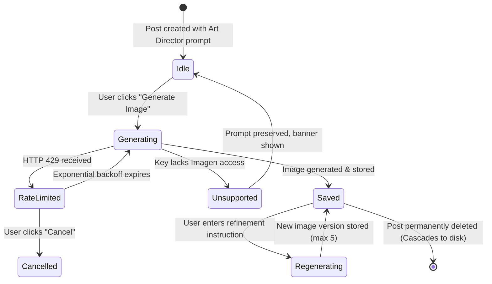

# Data Model: Post Images & Visual Generation

**Feature**: `008-post-images`  
**Date**: 2026-10-23  
**Status**: Ready  

---

## 1. Database Schema (`images` Table)

```sql
CREATE TABLE IF NOT EXISTS "images" (
    "id" UUID PRIMARY KEY DEFAULT gen_random_uuid(),
    "user_id" UUID NOT NULL REFERENCES "users"("id") ON DELETE CASCADE,
    "post_id" UUID NOT NULL REFERENCES "posts"("id") ON DELETE CASCADE,
    "storage_key" VARCHAR(512) NOT NULL,
    "mime_type" VARCHAR(64) NOT NULL DEFAULT 'image/png',
    "file_size_bytes" INTEGER NOT NULL,
    "width" INTEGER,
    "height" INTEGER,
    "aspect_ratio" VARCHAR(16) NOT NULL DEFAULT '16:9',
    "prompt" TEXT NOT NULL,
    "alt_text" TEXT,
    "refinement_instruction" TEXT,
    "version_number" INTEGER NOT NULL DEFAULT 1,
    "is_primary" BOOLEAN NOT NULL DEFAULT TRUE,
    "created_at" TIMESTAMPTZ NOT NULL DEFAULT NOW()
);

CREATE INDEX IF NOT EXISTS "images_user_id_idx" ON "images"("user_id");
CREATE INDEX IF NOT EXISTS "images_post_id_idx" ON "images"("post_id");
CREATE INDEX IF NOT EXISTS "images_post_id_primary_idx" ON "images"("post_id", "is_primary");
```

### TypeScript / Drizzle ORM Definition

```typescript
export const images = pgTable(
  'images',
  {
    id: uuid('id').defaultRandom().primaryKey(),
    userId: uuid('user_id')
      .notNull()
      .references(() => users.id, { onDelete: 'cascade' }),
    postId: uuid('post_id')
      .notNull()
      .references(() => posts.id, { onDelete: 'cascade' }),
    storageKey: varchar('storage_key', { length: 512 }).notNull(),
    mimeType: varchar('mime_type', { length: 64 }).notNull().default('image/png'),
    fileSizeBytes: integer('file_size_bytes').notNull(),
    width: integer('width'),
    height: integer('height'),
    aspectRatio: varchar('aspect_ratio', { length: 16 }).notNull().default('16:9'),
    prompt: text('prompt').notNull(),
    altText: text('alt_text'),
    refinementInstruction: text('refinement_instruction'),
    versionNumber: integer('version_number').notNull().default(1),
    isPrimary: boolean('is_primary').notNull().default(true),
    createdAt: timestamp('created_at', { withTimezone: true }).defaultNow().notNull(),
  },
  (table) => [
    index('images_user_id_idx').on(table.userId),
    index('images_post_id_idx').on(table.postId),
    index('images_post_id_primary_idx').on(table.postId, table.isPrimary),
  ],
);

export const imagesRelations = relations(images, ({ one }) => ({
  user: one(users, {
    fields: [images.userId],
    references: [users.id],
  }),
  post: one(posts, {
    fields: [images.postId],
    references: [posts.id],
  }),
}));
```

---

## 2. Validation Schemas (Zod)

```typescript
export const AspectRatioSchema = z.enum(['16:9', '1:1', '4:5', '9:16']);

export const GenerateImageRequestSchema = z.object({
  prompt: z.string().trim().min(3).max(2000).optional(),
  aspectRatio: AspectRatioSchema.default('16:9'),
  altText: z.string().trim().max(1000).optional(),
});

export const RegenerateImageRequestSchema = z.object({
  instruction: z.string().trim().min(2).max(1000),
  aspectRatio: AspectRatioSchema.optional(),
});

export const SetPrimaryImageRequestSchema = z.object({
  imageId: z.string().uuid(),
});
```

---

## 3. Storage Key Specification

- Storage keys follow a deterministic hierarchical layout:
  `images/{userId}/{postId}/{imageId}.{ext}`
- Example: `images/a1b2c3d4-e5f6-7890-abcd-ef1234567890/f9e8d7c6-b5a4-3210-fedc-ba9876543210/11223344-5566-7788-9900-aabbccddeeff.png`
- Security constraints:
  - No `..` segments permitted.
  - File extensions restricted to `.png`, `.jpg`, `.jpeg`, `.webp`.

---

## 4. State Transitions & Lifecycle

### Image Generation Lifecycle


### Retention & Pruning Logic
- When a new iteration is generated for `postId`:
  1. Count existing rows in `images` where `postId = :postId`.
  2. If count >= 5:
     - Find oldest record where `isPrimary = false` (or oldest if all equal).
     - Call `storageProvider.deleteImage(oldest.storageKey)`.
     - Delete row from `images`.
  3. Insert new row with `versionNumber = max(versionNumber) + 1` and `isPrimary = true` (clearing `isPrimary` on previous active image).
