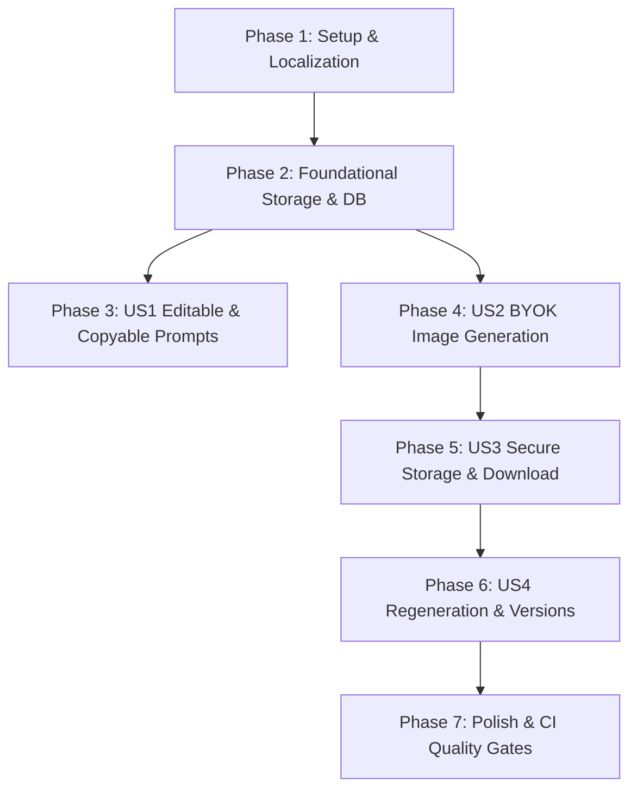

# Tasks: Post Images & Visual Generation

**Feature**: `008-post-images`  
**Input**: Design documents from `specs/008-post-images/` (`spec.md`, `plan.md`, `research.md`, `data-model.md`, `contracts/images-api.yaml`, `quickstart.md`)  
**Prerequisites**: `plan.md`, `spec.md`, `data-model.md`, `contracts/images-api.yaml`  

---

## Format: `[ID] [P?] [Story?] Description with file path`
- **[P]**: Can run in parallel (different files, no dependencies)
- **[Story]**: User story identifier ([US1], [US2], [US3], [US4])

---

## Phase 1: Setup & Infrastructure

**Purpose**: Localization dictionaries, AI configuration, and error classes for visual generation.

- [x] T001 Externalise visual and image strings across all three locales in `messages/en.json`, `messages/fr.json`, and `messages/ar.json`
- [x] T002 [P] Add `aiConfig.models.image` (`imagen-3.0-generate-002`) to runtime configuration in `src/lib/ai/config.ts`
- [x] T003 [P] Add `AiUnsupportedCapabilityError` and `AiSafetyBlockError` classes to `src/lib/ai/errors.ts`

---

## Phase 2: Foundational (Storage & Database)

**Purpose**: Core storage abstraction, database schema, migrations, and image service operations.

**⚠️ CRITICAL**: Must be completed before User Story implementation begins.

- [x] T004 Create `StorageProvider` interface (`saveImage`, `getImageStream`, `deleteImage`, `deleteImages`) in `src/lib/storage/provider.ts`
- [x] T005 [P] Implement `LocalStorageProvider` with directory containment and path-traversal safeguards in `src/lib/storage/local-storage.ts`
- [x] T006 Define `images` table schema, relations, and indexes with cascade deletion in `src/lib/db/schema.ts`
- [x] T007 Generate and apply Drizzle migration for the `images` table in `src/lib/db/migrations/`
- [x] T008 [P] Implement Zod validation schemas for image requests in `src/lib/validation/image-schemas.ts`
- [x] T009 Implement `ImageService` for database operations, retention pruning (max 5 iterations), and cascade cleanup in `src/lib/library/image-service.ts`

**Checkpoint**: Storage provider and database foundation verified.

---

## Phase 3: User Story 1 - Editable & Copyable Image Prompts (Priority: P1) 🎯 MVP

**Goal**: Every generated post displays an editable, copyable image prompt, aspect ratio badge, and accessibility alt text from the Art Director.

**Independent Test**: Generate or open any post in the library, edit the prompt or alt text, click "Copy Prompt", and verify clipboard content and 2-second feedback indicator.

### Tests for User Story 1
- [x] T010 [P] [US1] Unit test for image prompt validation and clipboard formatting in `tests/unit/image-schemas.test.ts`
- [x] T011 [P] [US1] Integration test for updating post visual metadata (`imagePrompt`, `aspectRatio`, `altText`) in `tests/integration/post-image-prompt.test.ts`

### Implementation for User Story 1
- [x] T012 [P] [US1] Create `ImagePromptCard` component with editable prompt, ratio badge, alt text, and copy action in `src/components/library/ImagePromptCard.tsx`
- [x] T013 [US1] Integrate `ImagePromptCard` into `PostCard.tsx` and `PostEditorModal.tsx` in `src/components/library/`
- [x] T014 [US1] Update `PostCard` copy actions to include accessible 2-second check feedback on prompt copy

**Checkpoint**: User Story 1 functional and independently testable.

---

## Phase 4: User Story 2 - Image Generation with BYOK & Graceful Degradation (Priority: P1)

**Goal**: Generate images directly inside Saouti using the user's provider key, with plain explanation when the key does not support image generation and transparent Art Director states.

**Independent Test**: Click "Generate Image" with an image-enabled key to generate a visual, or with a text-only key to verify that the UI shows a plain explanation banner leaving the prompt editable.

### Tests for User Story 2
- [x] T015 [P] [US2] Contract and unit tests for `AiProviderAdapter.generateImage` and capability detection in `tests/unit/gemini-image-adapter.test.ts`
- [x] T016 [P] [US2] Update `FakeAiAdapter` with simulated image generation behaviors (`success`, `unsupported_tier`, `rate_limit`) in `src/lib/ai/fake-adapter.ts`

### Implementation for User Story 2
- [x] T017 [US2] Extend `AiProviderAdapter` interface with `generateImage` and capability detection in `src/lib/ai/provider.ts`
- [x] T018 [US2] Implement Imagen 3 generation and error normalization (`AiUnsupportedCapabilityError`, `AiRateLimitError`) in `GeminiAdapter` in `src/lib/ai/gemini.ts`
- [x] T019 [P] [US2] Implement capability detection endpoint `GET /api/ai/capabilities/image` in `src/app/api/ai/capabilities/image/route.ts`
- [x] T020 [US2] Implement image generation endpoint `POST /api/posts/[id]/images/generate` in `src/app/api/posts/[id]/images/generate/route.ts`
- [x] T021 [P] [US2] Create `ImageCapabilityBanner` component for plain explanation of unsupported keys in `src/components/library/ImageCapabilityBanner.tsx`
- [x] T022 [US2] Implement Art Director generation progress, rate-limit countdown banner, and error states in `src/components/library/PostCard.tsx`

**Checkpoint**: User Story 2 functional with graceful degradation and transparent agent states.

---

## Phase 5: User Story 3 - Secure Storage, Attachment & One-Click Download (Priority: P1)

**Goal**: Privately store generated images, attach them to posts, allow one-click download, and cascade delete all files when the post is deleted.

**Independent Test**: Generate an image, click "Download Image" to verify file downloaded with proper MIME type and filename, and delete the post to verify DB records and disk files are purged.

### Tests for User Story 3
- [x] T023 [P] [US3] Unit tests for `LocalStorageProvider` file operations, directory containment, and traversal safeguards in `tests/unit/local-storage.test.ts`
- [x] T024 [P] [US3] Integration tests for authenticated image streaming, cross-user isolation (403/404), and cascading deletion in `tests/integration/image-auth-cascade.test.ts`

### Implementation for User Story 3
- [x] T025 [US3] Implement authenticated private image streaming endpoint `GET /api/posts/[id]/images/[imageId]` in `src/app/api/posts/[id]/images/[imageId]/route.ts`
- [x] T026 [P] [US3] Implement image download endpoint with Content-Disposition `GET /api/posts/[id]/images/[imageId]/download` in `src/app/api/posts/[id]/images/[imageId]/download/route.ts`
- [x] T027 [US3] Hook image binary file deletion to post permanent purge in `src/lib/library/post-service.ts`
- [x] T028 [US3] Create `ImagePreviewGallery` component with download button, alt text, and image rendering in `src/components/library/ImagePreviewGallery.tsx`

**Checkpoint**: User Story 3 complete with secure serving and cascading deletion verified.

---

## Phase 6: User Story 4 - Image Regeneration with Custom Instructions (Priority: P2)

**Goal**: Regenerate images with custom refinement instructions while retaining earlier visual versions on the post (up to 5 versions with FIFO pruning).

**Independent Test**: Enter a refinement instruction, click "Regenerate", verify a new image version is created, and switch between thumbnail variants.

### Tests for User Story 4
- [x] T029 [P] [US4] Integration tests for multi-image versioning, regeneration instruction handling, and FIFO 5-version retention in `tests/integration/image-regeneration.test.ts`

### Implementation for User Story 4
- [x] T030 [US4] Implement image regeneration endpoint `POST /api/posts/[id]/images/regenerate` in `src/app/api/posts/[id]/images/regenerate/route.ts`
- [x] T031 [P] [US4] Implement primary image selection endpoint `PATCH /api/posts/[id]/images/[imageId]/primary` in `src/app/api/posts/[id]/images/[imageId]/primary/route.ts`
- [x] T032 [P] [US4] Implement image iteration deletion endpoint `DELETE /api/posts/[id]/images/[imageId]` in `src/app/api/posts/[id]/images/[imageId]/route.ts`
- [x] T033 [US4] Create `ImageRegenerateModal` dialog for refinement instructions in `src/components/library/ImageRegenerateModal.tsx`
- [x] T034 [US4] Add thumbnail version switcher and primary badge toggle to `src/components/library/ImagePreviewGallery.tsx`

**Checkpoint**: User Story 4 complete with iterative visual versioning.

---

## Phase 7: Polish & Cross-Cutting Quality Gates

**Purpose**: Accessibility checks, RTL Arabic verification, E2E test suite, and full CI validation.

- [x] T035 [P] Playwright E2E tests for image controls and download flow in `tests/e2e/post-image-controls.spec.ts`
- [x] T036 [P] Playwright E2E tests for RTL layout and Arabic rendering in `tests/e2e/post-image-rtl.spec.ts`
- [x] T037 [P] Automated accessibility audit (`axe-core`) for image cards, modals, and previews in `tests/e2e/post-image-a11y.spec.ts`
- [x] T038 Run full quality gate validation: `pnpm type-check`, `pnpm lint`, `pnpm test`, and `pnpm build`

---

## Dependencies & Execution Order

### Parallel Execution Opportunities
- **Phase 1**: T002 and T003 can run in parallel with T001.
- **Phase 2**: T005, T008 can run in parallel after T004.
- **Phase 3**: T010, T011, and T012 can run in parallel.
- **Phase 4**: T015, T016, T019, and T021 can run in parallel.
- **Phase 5**: T023, T024, and T026 can run in parallel.
- **Phase 6**: T029, T031, and T032 can run in parallel.
- **Phase 7**: T035, T036, and T037 can run in parallel.

---

## Summary Statistics

- **Total Tasks**: 38
- **Tasks per Phase**:
  - Phase 1 (Setup): 3
  - Phase 2 (Foundational): 6
  - Phase 3 (US1 - MVP): 5
  - Phase 4 (US2): 8
  - Phase 5 (US3): 6
  - Phase 6 (US4): 6
  - Phase 7 (Polish): 4
- **Parallel Opportunities**: 18 tasks marked `[P]`
- **MVP Scope**: Phases 1, 2, and 3 (delivers editable, copyable Art Director prompts across all platforms)
