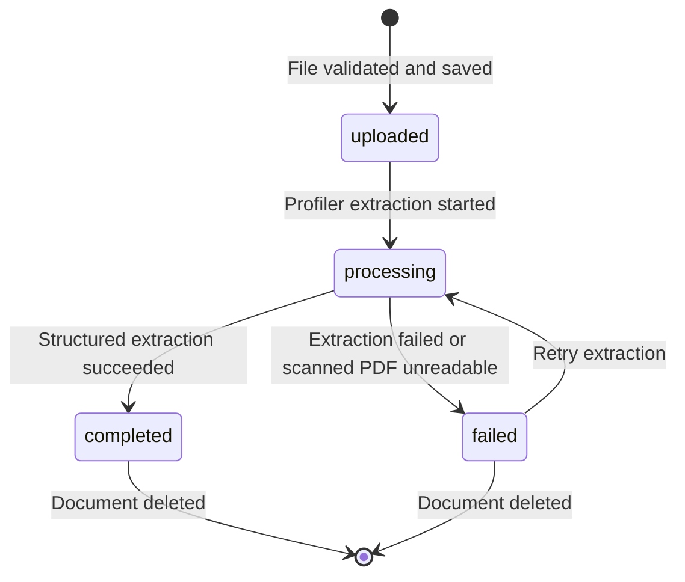
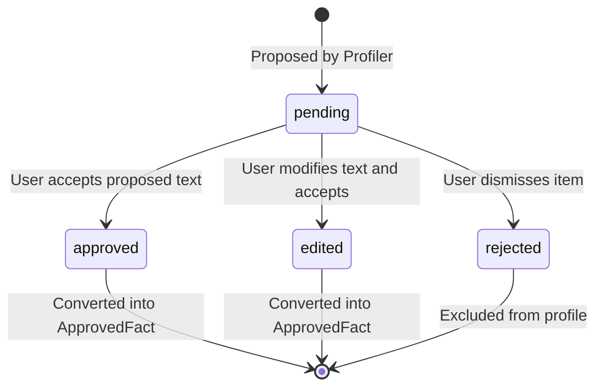

# Data Model: Profile Documents (PDF)

**Feature**: `010-profile-documents`  
**Date**: 2026-10-24  
**Status**: Completed  

---

## 1. Database Entities & Tables (PostgreSQL 16 via Drizzle ORM)

### 1.1 `documents`
Represents an uploaded PDF file associated with a user's Voice Profile.

```typescript
export const documents = pgTable('documents', {
  id: uuid('id').primaryKey().default(sql`gen_random_uuid()`),
  userId: uuid('user_id').notNull().references(() => users.id, { onDelete: 'cascade' }),
  storageKey: varchar('storage_key', { length: 500 }).notNull(),
  originalFileName: varchar('original_file_name', { length: 255 }).notNull(),
  fileSizeBytes: integer('file_size_bytes').notNull(),
  pageCount: integer('page_count').notNull().default(1),
  documentType: varchar('document_type', { length: 50 }).notNull(), // 'cv' | 'bio' | 'articles' | 'company_brochure' | 'other'
  status: varchar('status', { length: 30 }).notNull().default('uploaded'), // 'uploaded' | 'processing' | 'completed' | 'failed'
  extractedTextEncrypted: text('extracted_text_encrypted'), // AES-256-GCM ciphertext
  nonce: varchar('nonce', { length: 32 }), // IV for AES-256-GCM
  authTag: varchar('auth_tag', { length: 32 }), // Tag for AES-256-GCM
  errorMessage: text('error_message'),
  createdAt: timestamp('created_at', { withTimezone: true }).defaultNow().notNull(),
  updatedAt: timestamp('updated_at', { withTimezone: true }).defaultNow().notNull(),
}, (table) => ({
  userDocumentIdx: index('documents_user_id_idx').on(table.userId),
  statusIdx: index('documents_status_idx').on(table.status),
}));
```

### 1.2 `document_insights`
Stores structured insights proposed by the Profiler agent from a processed document.

```typescript
export const documentInsights = pgTable('document_insights', {
  id: uuid('id').primaryKey().default(sql`gen_random_uuid()`),
  documentId: uuid('document_id').notNull().references(() => documents.id, { onDelete: 'cascade' }),
  userId: uuid('user_id').notNull().references(() => users.id, { onDelete: 'cascade' }),
  category: varchar('category', { length: 50 }).notNull(), // 'roles_experience' | 'expertise' | 'achievements' | 'audience_cues' | 'tone_style_cues' | 'languages'
  rawText: text('raw_text').notNull(),
  editedText: text('edited_text'),
  sourcePage: integer('source_page').notNull().default(1),
  confidenceScore: integer('confidence_score').notNull().default(100), // 0 to 100 percentage
  status: varchar('status', { length: 30 }).notNull().default('pending'), // 'pending' | 'approved' | 'edited' | 'rejected'
  reviewedAt: timestamp('reviewed_at', { withTimezone: true }),
  createdAt: timestamp('created_at', { withTimezone: true }).defaultNow().notNull(),
}, (table) => ({
  docInsightIdx: index('document_insights_document_id_idx').on(table.documentId),
  userInsightStatusIdx: index('document_insights_user_status_idx').on(table.userId, table.status),
}));
```

### 1.3 `approved_facts`
Stores verified factual details and metrics directly available to the Writer and verified by the Critic.

```typescript
export const approvedFacts = pgTable('approved_facts', {
  id: uuid('id').primaryKey().default(sql`gen_random_uuid()`),
  userId: uuid('user_id').notNull().references(() => users.id, { onDelete: 'cascade' }),
  sourceDocumentId: uuid('source_document_id').references(() => documents.id, { onDelete: 'set null' }),
  sourceInsightId: uuid('source_insight_id').references(() => documentInsights.id, { onDelete: 'set null' }),
  factCategory: varchar('fact_category', { length: 50 }).notNull().default('general'), // 'achievement' | 'credential' | 'metric' | 'experience' | 'general'
  factText: text('fact_text').notNull(),
  sourceCitation: varchar('source_citation', { length: 255 }), // e.g. "CV, Page 2"
  isActive: boolean('is_active').notNull().default(true),
  createdAt: timestamp('created_at', { withTimezone: true }).defaultNow().notNull(),
  updatedAt: timestamp('updated_at', { withTimezone: true }).defaultNow().notNull(),
}, (table) => ({
  userFactsIdx: index('approved_facts_user_id_idx').on(table.userId),
  docFactsIdx: index('approved_facts_source_doc_idx').on(table.sourceDocumentId),
}));
```

### 1.4 `document_privacy_consents`
Records explicit user acknowledgment of the document processing privacy notice.

```typescript
export const documentPrivacyConsents = pgTable('document_privacy_consents', {
  id: uuid('id').primaryKey().default(sql`gen_random_uuid()`),
  userId: uuid('user_id').notNull().unique().references(() => users.id, { onDelete: 'cascade' }),
  acknowledgedAt: timestamp('acknowledged_at', { withTimezone: true }).defaultNow().notNull(),
  noticeVersion: varchar('notice_version', { length: 20 }).notNull().default('v1'),
}, (table) => ({
  userConsentIdx: index('doc_privacy_consent_user_idx').on(table.userId),
}));
```

---

## 2. State Transitions & Lifecycle

### 2.1 Document Status


### 2.2 Insight Review Status


---

## 3. Validation Rules (Zod Schemas)

1. **Document Upload**:
   - `file`: Required, MIME `application/pdf`, magic byte `%PDF-`, size ≤ 10,485,760 bytes (10 MB), page count ≤ 20.
   - `documentType`: Required enum (`cv` | `bio` | `articles` | `company_brochure` | `other`).
2. **Insight Review Action**:
   - `action`: Enum (`accept` | `edit` | `reject`).
   - `editedText`: Required string (1 - 400 chars) if `action === 'edit'`.
3. **Document Deletion**:
   - `keepApprovedFacts`: Boolean, default `true`.
