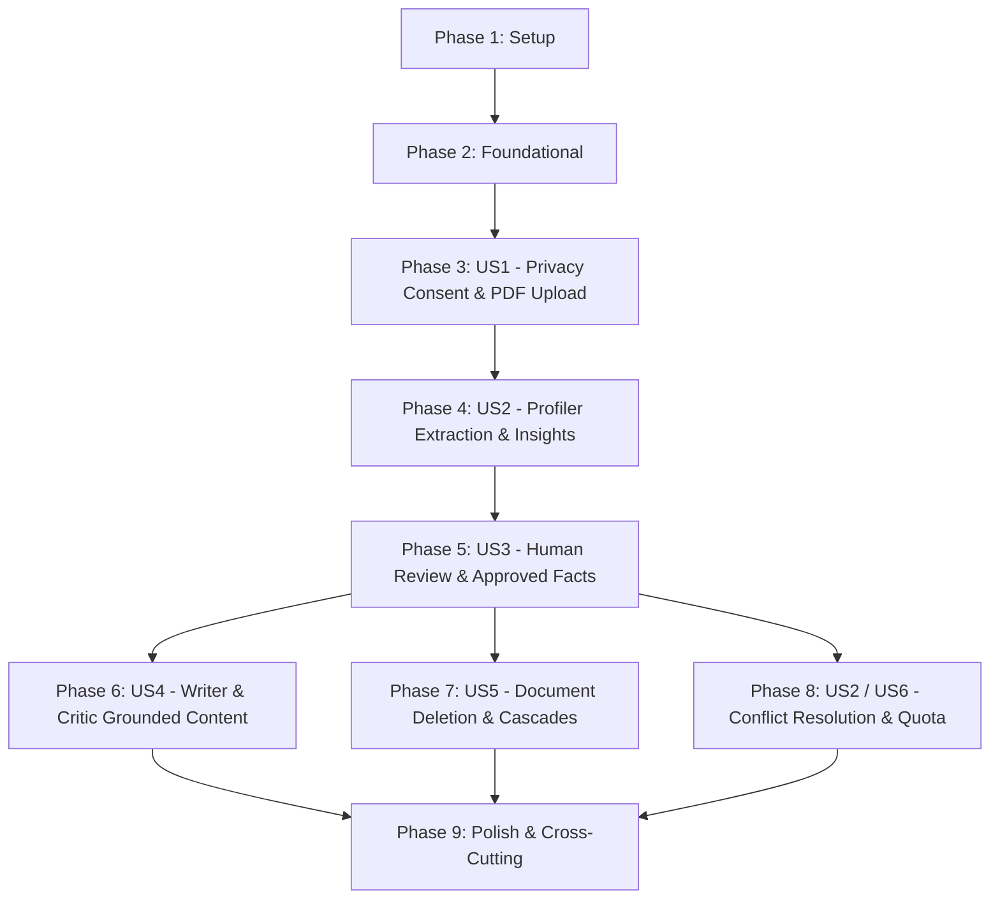

# Tasks: Profile Documents (PDF)

**Input**: Design documents from `/specs/010-profile-documents/`  
**Prerequisites**: [plan.md](file:///c:/Users/Ramzi/.gemini/antigravity/scratch/Saouti/specs/010-profile-documents/plan.md), [spec.md](file:///c:/Users/Ramzi/.gemini/antigravity/scratch/Saouti/specs/010-profile-documents/spec.md), [research.md](file:///c:/Users/Ramzi/.gemini/antigravity/scratch/Saouti/specs/010-profile-documents/research.md), [data-model.md](file:///c:/Users/Ramzi/.gemini/antigravity/scratch/Saouti/specs/010-profile-documents/data-model.md), [contracts/documents-api.yaml](file:///c:/Users/Ramzi/.gemini/antigravity/scratch/Saouti/specs/010-profile-documents/contracts/documents-api.yaml)

**Tests**: Test tasks are included per the specification test plan (unit tests, integration suites, security injection suites, and golden-profile evaluation).

**Organization**: Tasks are grouped by user story to enable independent implementation and testing of each story.

## Format: `- [ ] [TaskID] [P?] [Story?] Description with file path`

- **[P]**: Can run in parallel (different files, no dependencies)
- **[Story]**: Which user story this task belongs to (e.g., `[US1]`, `[US2]`, `[US3]`, `[US4]`, `[US5]`, `[US6]`)
- Setup, Foundational, and Polish phases have NO story label. User Story phases MUST have the `[Story]` label.
- Exact file paths are included in every task description.

---

## Phase 1: Setup (Shared Infrastructure)

**Purpose**: Project initialization, dependency installation, internationalization strings, and testing fixtures.

- [x] T001 Install `unpdf` library for server-side PDF parsing in package.json
- [x] T002 [P] Externalize English document strings (privacy notice, labels, categories, status badges, errors) in messages/en.json
- [x] T003 [P] Externalize French document strings in messages/fr.json
- [x] T004 [P] Externalize Arabic document strings with RTL-appropriate terminology in messages/ar.json
- [x] T005 [P] Create mock PDF test fixtures (valid English CV, French bio, Arabic article, scanned PDF, encrypted PDF, injection prompt PDF) in tests/fixtures/documents/

---

## Phase 2: Foundational (Blocking Prerequisites)

**Purpose**: Database schema, private volume storage abstraction extensions, and validation schemas that MUST be complete before user stories can begin.

**⚠️ CRITICAL**: No user story work can begin until this foundational phase is complete.

- [x] T006 Extend storage provider interface with folder deletion and prefix purging capabilities in src/lib/storage/provider.ts
- [x] T007 Implement private `documents/` path isolation, directory cleanup, and authenticated streaming support in src/lib/storage/local-storage.ts
- [x] T008 Define Drizzle ORM schema for `documents`, `document_insights`, `approved_facts`, and `document_privacy_consents` in src/lib/db/schema.ts
- [x] T009 Generate and run Drizzle migration `0008_profile_documents.sql` in src/lib/db/migrations/
- [x] T010 [P] Define Zod validation schemas for document upload, review actions, and deletion options in src/lib/documents/schemas.ts
- [x] T011 [P] Unit tests for storage provider document operations and path traversal defense in tests/unit/storage-provider.test.ts

**Checkpoint**: Foundation ready — database tables active, storage volume ready, user story implementation can begin.

---

## Phase 3: User Story 1 - Privacy Notice, Consent & PDF Document Upload (Priority: P1) 🎯 MVP

**Goal**: Enable users to view and acknowledge the unskippable privacy notice, upload up to 5 labeled PDFs (max 10 MB, 20 pages), reject encrypted or non-PDF files, and store binaries privately.

**Independent Test**: Navigate to the Documents section, confirm upload is blocked until acknowledging consent, upload a valid PDF with a label, and verify encrypted PDFs or files over 5 are rejected with friendly errors.

### Tests for User Story 1

- [x] T012 [P] [US1] Unit tests for PDF magic byte validation, encrypted PDF detection, and page count checks in tests/unit/pdf-extractor.test.ts
- [x] T013 [P] [US1] Integration tests for privacy consent gate and document upload endpoint (enforcing 5-document limit, size/page caps) in tests/integration/document-upload-flow.test.ts

### Implementation for User Story 1

- [x] T014 [US1] Implement server-side PDF validation, encryption check, and page extractor in src/lib/documents/pdf-extractor.ts
- [x] T015 [US1] Implement document service operations for consent logging, document creation, and AES-256-GCM encryption of extracted text in src/lib/documents/document-service.ts
- [x] T016 [US1] Implement privacy notice consent API endpoints (GET / POST) in src/app/api/profile/documents/consent/route.ts
- [x] T017 [US1] Implement document listing and PDF upload API route (POST / GET) in src/app/api/profile/documents/route.ts
- [x] T018 [US1] Implement authenticated private PDF file streaming route for owners only in src/app/api/profile/documents/[id]/file/route.ts
- [x] T019 [P] [US1] Build accessible `DocumentPrivacyConsentModal.tsx` blocking uploads until acknowledged in src/components/profile/documents/DocumentPrivacyConsentModal.tsx
- [x] T020 [P] [US1] Build `DocumentUploadZone.tsx` with drag-and-drop, 5-document cap indicator, and type label selector in src/components/profile/documents/DocumentUploadZone.tsx
- [x] T021 [P] [US1] Build `DocumentList.tsx` showing uploaded files, status chips, and file sizes in src/components/profile/documents/DocumentList.tsx
- [x] T022 [US1] Integrate Documents management tab into `VoiceProfileWizard.tsx` in src/components/profile/VoiceProfileWizard.tsx

**Checkpoint**: User Story 1 functional and independently testable — users can consent, upload up to 5 valid PDFs, and view them securely.

---

## Phase 4: User Story 2 - Profiler Extraction & Structured Insights Proposal (Priority: P1)

**Goal**: Profiler agent extracts text page-by-page from uploaded PDFs, proposes structured insights across 6 categories citing source pages, falls back to Gemini multimodal reading for scanned files, and isolates text in XML tags against prompt injections.

**Independent Test**: Trigger extraction on an uploaded PDF and verify that categorized insights (`roles_experience`, `expertise`, `achievements`, `audience_cues`, `tone_style_cues`, `languages`) are proposed with page citations and streamed via SSE.

### Tests for User Story 2

- [x] T023 [P] [US2] Unit tests for Profiler document extraction runner, structured Zod parsing, and prompt injection defense in tests/unit/profiler-document.test.ts
- [x] T024 [P] [US2] Integration test for scanned PDF fallback via multimodal provider adapter in tests/integration/document-scanned-fallback.test.ts

### Implementation for User Story 2

- [x] T025 [US2] Create Profiler document extraction prompt with XML delimiter isolation and injection defense in src/lib/agent-engine/prompts/profiler-document.v1.md
- [x] T026 [US2] Implement Profiler document extraction runner with page chunking, structured output parsing, and scanned fallback in src/lib/agent-engine/agents/profiler-document.ts
- [x] T027 [US2] Implement extraction trigger API endpoint emitting live progress SSE events in src/app/api/profile/documents/[id]/extract/route.ts
- [x] T028 [US2] Implement document insights retrieval API route in src/app/api/profile/documents/[id]/insights/route.ts
- [x] T029 [US2] Update agent activity stream and presence indicator to reflect active document reading in src/components/agent-engine/AgentPresence.tsx
- [x] T030 [US2] Connect extraction trigger button and live progress status in src/components/profile/documents/DocumentList.tsx

**Checkpoint**: User Stories 1 AND 2 functional — documents extract into structured, categorized insights with source page references.

---

## Phase 5: User Story 3 - Human-in-the-Loop Review & Approved Facts Creation (Priority: P1)

**Goal**: Provide an interactive review interface where users individually accept, edit, or reject proposed insights; accepted achievements/details become `Approved Facts` displayed in the "What the AI sees" preview.

**Independent Test**: Open the review drawer for a processed document, accept/edit/reject items, verify only approved items become active approved facts, and confirm they appear in the summary preview.

### Tests for User Story 3

- [x] T031 [P] [US3] Unit tests for insight review state transitions (`pending` -> `approved` | `edited` | `rejected`) and ApprovedFact conversion in tests/unit/insight-review.test.ts
- [x] T032 [P] [US3] Integration test verifying approved facts inclusion in profile summary snapshot and exclusion of rejected items in tests/integration/profile-summary-facts.test.ts

### Implementation for User Story 3

- [x] T033 [US3] Implement insight review service logic (accept, edit, reject, and ApprovedFact persistence) in src/lib/documents/document-service.ts
- [x] T034 [US3] Implement insight review API endpoint in src/app/api/profile/documents/insights/[insightId]/review/route.ts
- [x] T035 [US3] Implement approved facts listing API route in src/app/api/profile/facts/route.ts
- [x] T036 [P] [US3] Build `InsightReviewCard.tsx` with source page citation, inline edit form, and accept/reject actions in src/components/profile/documents/InsightReviewCard.tsx
- [x] T037 [P] [US3] Build `InsightReviewDrawer.tsx` grouping proposed insights by category with filter tabs in src/components/profile/documents/InsightReviewDrawer.tsx
- [x] T038 [P] [US3] Build `ApprovedFactsList.tsx` showing active verified facts and citations in src/components/profile/documents/ApprovedFactsList.tsx
- [x] T039 [US3] Update profile summary builder and "What the AI sees" preview dialog to display approved document facts and insights in src/lib/profile/summary-builder.ts

**Checkpoint**: User Stories 1, 2, and 3 functional — zero unreviewed insights committed; human-in-the-loop review generates verified facts.

---

## Phase 6: User Story 4 - Grounded Content Drafting & Factual Claim Auditing (Priority: P1)

**Goal**: Writer agent strictly incorporates `<approved_facts>` when drafting posts (rule 4) and uses bracketed placeholders for ungrounded specifics; Critic agent audits factual claims against `<approved_facts>`; legacy profiles experience zero regression.

**Independent Test**: Generate posts with approved facts present, verifying the Writer uses `<approved_facts>` without hallucinating details, and Critic docks score for ungrounded claims; run golden profile eval suite to verify legacy profiles behave identically.

### Tests for User Story 4

- [x] T040 [P] [US4] Unit tests for Writer `<approved_facts>` injection and Critic claim verification in tests/unit/approved-facts-pipeline.test.ts
- [x] T041 [P] [US4] Run and verify Golden Profile evaluation suite with prompt versions v1 and v2 in tests/evaluation/agent-engine-eval.test.ts

### Implementation for User Story 4

- [x] T042 [US4] Create Writer agent prompt v2 enforcing `<approved_facts>` usage and placeholder insertion in src/lib/agent-engine/prompts/writer.v2.md
- [x] T043 [US4] Create Critic agent prompt v2 auditing claims against `<approved_facts>` and flagging ungrounded claims in src/lib/agent-engine/prompts/critic.v2.md
- [x] T044 [US4] Update prompt builder to assemble `<approved_facts>` XML block from user's active approved facts in src/lib/agent-engine/prompt-builder.ts
- [x] T045 [US4] Update Writer agent runner to support prompt version v2 and inject approved facts in src/lib/agent-engine/agents/writer.ts
- [x] T046 [US4] Update Critic agent runner to support prompt version v2 and verify claims against approved facts in src/lib/agent-engine/agents/critic.ts
- [x] T047 [US4] Ensure backward compatibility for users with zero documents (omit `<approved_facts>` block cleanly) in src/lib/agent-engine/prompt-builder.ts

**Checkpoint**: User Stories 1 through 4 functional — drafts strictly grounded in verified facts with Critic auditing.

---

## Phase 7: User Story 5 - Document Deletion & Cascade Controls (Priority: P1)

**Goal**: Enable users to delete an uploaded document with an explicit choice to keep or remove approved facts; permanently purge binary files and extracted text; ensure account deletion cascades completely.

**Independent Test**: Delete a document selecting Option A (keep facts) and verify facts remain while files/insights are purged; delete with Option B (remove facts) and verify facts are removed; test account deletion cascade.

### Tests for User Story 5

- [x] T048 [P] [US5] Integration tests for document deletion (Option A retain facts vs Option B purge facts) in tests/integration/document-deletion.test.ts
- [x] T049 [P] [US5] Integration test for complete account deletion cascade (DB records and physical storage files) in tests/integration/document-account-cascade.test.ts

### Implementation for User Story 5

- [x] T050 [US5] Implement document deletion logic with `keepApprovedFacts` query parameter and storage binary purge in src/lib/documents/document-service.ts
- [x] T051 [US5] Implement document deletion API endpoint (DELETE /api/profile/documents/[id]) in src/app/api/profile/documents/[id]/route.ts
- [x] T052 [P] [US5] Build `DocumentDeleteModal.tsx` presenting explicit radio choices (keep vs remove facts) in src/components/profile/documents/DocumentDeleteModal.tsx
- [x] T053 [US5] Connect delete modal and deletion trigger to document actions menu in src/components/profile/documents/DocumentList.tsx
- [x] T054 [US5] Update account deletion route to purge user's private documents directory from storage volume in src/app/api/auth/delete-account/route.ts

**Checkpoint**: User Stories 1 through 5 complete — data sovereignty, GDPR right to erasure, and full lifecycle control delivered.

---

## Phase 8: User Story 6 - Conflict Resolution & Quota Pre-Check (Priority: P2)

**Goal**: Display visual conflict badges when extracted document details conflict with existing profile fields (e.g., job titles), allowing users to pick which to preserve; display a quota usage estimate prior to extraction.

**Independent Test**: Extract a document with conflicting role information, verify conflict badge appears in review card showing "Current Profile" vs "Document Proposal", and check quota estimator before extraction.

### Tests for User Story 6

- [x] T055 [P] [US6] Unit tests for profile conflict detection comparator in tests/unit/conflict-detector.test.ts

### Implementation for User Story 6

- [x] T056 [US6] Implement conflict detection comparator between existing profile fields and extracted insights in src/lib/documents/conflict-detector.ts
- [x] T057 [P] [US6] Build `InsightConflictBadge.tsx` comparing profile vs document proposal with selection toggles in src/components/profile/documents/InsightConflictBadge.tsx
- [x] T058 [US6] Integrate conflict badge into `InsightReviewCard.tsx` in src/components/profile/documents/InsightReviewCard.tsx
- [x] T059 [P] [US6] Build `QuotaEstimateBanner.tsx` displaying expected token/request usage prior to extraction in src/components/profile/documents/QuotaEstimateBanner.tsx

**Checkpoint**: All 6 user stories complete — conflict resolution and quota awareness operational.

---

## Phase 9: Polish & Cross-Cutting Concerns

**Purpose**: Security reviews, accessibility scans, RTL verification, type-safety, and test suite verification.

### Security & Privacy (Principle 2)

- [x] T060 [P] Security review: verify all document queries and storage paths enforce strict user ID scoping in src/lib/documents/document-service.ts
- [x] T061 [P] Security review: confirm extracted text is encrypted at rest (AES-256-GCM) and never logged in plain text in src/lib/documents/document-service.ts
- [x] T062 Prompt-injection adversarial test: verify adversarial PDFs fail to execute instructions or hijack agent turns in tests/security/document-injection.test.ts

### Accessibility & Localisation (Principle 6)

- [x] T063 [P] Accessibility audit: run automated axe-core scans on DocumentPrivacyConsentModal, DocumentUploadZone, and InsightReviewDrawer in tests/e2e/document-a11y.spec.ts
- [x] T064 [P] Verify keyboard navigation (`Tab`, `Space`, `Enter`, `Escape`) and WCAG AA contrast for all document UI components in src/components/profile/documents/
- [x] T065 [P] RTL layout verification: verify Arabic text alignment, chevron mirroring, and badge orientation in src/components/profile/documents/

### Quality Gates (Principle 8)

- [x] T066 [P] Execute linter with zero errors (`pnpm lint`)
- [x] T067 [P] Execute TypeScript compiler with zero errors (`pnpm type-check`)
- [x] T068 Run all unit and integration test suites (`pnpm test`)
- [x] T069 Verify production build succeeds (`pnpm build`)
- [x] T070 Execute end-to-end user journey validation per quickstart.md in tests/e2e/profile-documents.spec.ts

---

## Dependencies & Execution Order

### Phase Dependencies



- **Setup (Phase 1)**: No dependencies — can start immediately.
- **Foundational (Phase 2)**: Depends on Phase 1 — BLOCKS all user stories.
- **User Story 1 (P1)**: Depends on Phase 2 — unlocks document intake.
- **User Story 2 (P1)**: Depends on US1 (requires uploaded documents to extract).
- **User Story 3 (P1)**: Depends on US2 (requires extracted insights to review).
- **User Story 4 (P1)**: Depends on US3 (requires approved facts for Writer/Critic).
- **User Story 5 (P1)**: Depends on US1/US3 (can run in parallel with US4 once facts exist).
- **User Story 6 (P2)**: Depends on US3 (enhances review and extraction UI).
- **Polish (Phase 9)**: Runs after desired user stories are implemented.

---

## Parallel Execution Opportunities

### User Story 1
```bash
# Parallel test writing:
Task T012: Unit tests in tests/unit/pdf-extractor.test.ts
Task T013: Integration tests in tests/integration/document-upload-flow.test.ts

# Parallel UI component building:
Task T019: DocumentPrivacyConsentModal.tsx in src/components/profile/documents/
Task T020: DocumentUploadZone.tsx in src/components/profile/documents/
Task T021: DocumentList.tsx in src/components/profile/documents/
```

### User Story 3
```bash
# Parallel UI components for review:
Task T036: InsightReviewCard.tsx in src/components/profile/documents/
Task T037: InsightReviewDrawer.tsx in src/components/profile/documents/
Task T038: ApprovedFactsList.tsx in src/components/profile/documents/
```

### User Story 4
```bash
# Parallel prompt creation:
Task T042: Writer prompt v2 in src/lib/agent-engine/prompts/writer.v2.md
Task T043: Critic prompt v2 in src/lib/agent-engine/prompts/critic.v2.md
```

---

## Implementation Strategy

### MVP First (Phases 1, 2, and 3: User Story 1 Only)
1. Complete Phase 1 (Setup: `unpdf`, locales, fixtures).
2. Complete Phase 2 (Foundational: schema, migrations, storage).
3. Complete Phase 3 (User Story 1: consent modal, upload dropzone, private file storage).
4. **STOP and VALIDATE**: Verify upload, size/page limits, encrypted rejection, and privacy consent independently.

### Incremental Delivery (All Phases)
1. **Increment 1 (MVP)**: Consent gate and PDF upload working end-to-end.
2. **Increment 2**: Profiler extraction proposing structured insights with page citations.
3. **Increment 3**: Human-in-the-loop review drawer converting accepted items into approved facts.
4. **Increment 4**: Writer and Critic prompts updated with `<approved_facts>` and golden profile evaluation.
5. **Increment 5**: Document deletion with retain/remove choice and account deletion cascade.
6. **Increment 6**: Conflict detection and quota pre-check.
7. **Increment 7**: Polish, a11y, RTL Arabic verification, and full quality gates.
