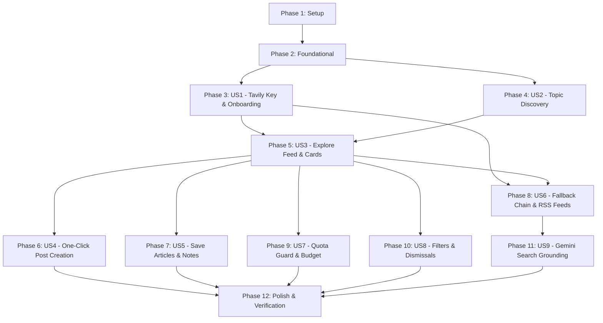

# Tasks: Explore (with Tavily Search)

**Input**: Design documents from `/specs/011-explore/`  
**Prerequisites**: [plan.md](file:///c:/Users/Ramzi/.gemini/antigravity/scratch/Saouti/specs/011-explore/plan.md), [spec.md](file:///c:/Users/Ramzi/.gemini/antigravity/scratch/Saouti/specs/011-explore/spec.md), [research.md](file:///c:/Users/Ramzi/.gemini/antigravity/scratch/Saouti/specs/011-explore/research.md), [data-model.md](file:///c:/Users/Ramzi/.gemini/antigravity/scratch/Saouti/specs/011-explore/data-model.md), [contracts/explore-api.yaml](file:///c:/Users/Ramzi/.gemini/antigravity/scratch/Saouti/specs/011-explore/contracts/explore-api.yaml)

**Tests**: Test tasks are included per the specification test plan (unit tests, integration suites, query privacy assertions, adversarial injection suites, and WCAG AA accessibility tests).

**Organization**: Tasks are grouped by user story to enable independent implementation and testing of each story.

## Format: `- [ ] [TaskID] [P?] [Story?] Description with file path`

- **[P]**: Can run in parallel (different files, no dependencies)
- **[Story]**: Which user story this task belongs to (e.g., `[US1]`, `[US2]`, `[US3]`, `[US4]`, `[US5]`, `[US6]`, `[US7]`, `[US8]`, `[US9]`)
- Setup, Foundational, and Polish phases have NO story label. User Story phases MUST have the `[Story]` label.
- Exact file paths are included in every task description.

---

## Phase 1: Setup (Shared Infrastructure)

**Purpose**: Project initialization, dependency installation, internationalization strings, and testing fixtures.

- [x] T001 Install `fast-xml-parser` library for RSS/Atom fallback feed parsing in package.json
- [x] T002 [P] Externalize English Explore strings (onboarding guide, key inputs, topic chips, cards, filters, error states) in messages/en.json
- [x] T003 [P] Externalize French Explore strings in messages/fr.json
- [x] T004 [P] Externalize Arabic Explore strings with RTL-appropriate terminology in messages/ar.json
- [x] T005 [P] Create mock search response and RSS feed fixtures (Tavily JSON, Tech RSS XML, Business Atom XML, injection payload) in tests/fixtures/explore/

---

## Phase 2: Foundational (Blocking Prerequisites)

**Purpose**: Database schema extensions, migration generation, Zod schemas, search provider interface, and URL normalizer that MUST be complete before user stories can begin.

**⚠️ CRITICAL**: No user story work can begin until this foundational phase is complete.

- [x] T006 Define Drizzle ORM schema for `topics`, `articles`, `saved_articles`, `article_dismissals`, `search_usage_counters`, and extend `api_keys` with `provider` and `users` with `has_dismissed_tavily_prompt` in src/lib/db/schema.ts
- [x] T007 Generate and run Drizzle migration `0009_explore_tavily.sql` in src/lib/db/migrations/
- [x] T008 [P] Define Zod validation schemas for Tavily keys, topics, feed queries, and saved articles in src/lib/explore/schemas.ts
- [x] T009 [P] Implement canonical URL normalizer stripping analytics/tracking parameters and trailing slashes in src/lib/search/url-normalizer.ts
- [x] T010 [P] Define `SearchProvider` interface and result types in src/lib/search/provider.ts
- [x] T011 [P] Unit tests for URL normalizer and Zod validation schemas in tests/unit/explore-schemas.test.ts

**Checkpoint**: Foundation ready — database tables active, schema types available, search provider interface established, user story implementation can begin.

---

## Phase 3: User Story 1 - Tavily Search Key Setup & Guided Onboarding (Priority: P1) 🎯 MVP

**Goal**: Enable users to add their free Tavily search API key during onboarding (step 2) or Settings with multi-language guides (EN, FR, AR), secure AES-256-GCM encryption, last 4 characters preview, skip option, and a one-time dismissible banner for existing users.

**Independent Test**: Navigate to onboarding step 2 or Settings -> Keys. Enter a valid Tavily key; confirm it is validated before saving, stored encrypted, masked to only the last 4 characters, and that skipping the step proceeds normally without blocking access.

### Tests for User Story 1

- [x] T012 [P] [US1] Unit tests for Tavily key validation regex and AES-256-GCM encryption in tests/unit/tavily-key.test.ts
- [x] T013 [P] [US1] Integration tests for onboarding Tavily key step, skip flow, and Settings key management in tests/integration/tavily-onboarding.test.ts

### Implementation for User Story 1

- [x] T014 [US1] Implement multi-provider key vault operations (save, get, delete Tavily key with masking to last 4 chars) in src/lib/auth/keys.ts
- [x] T015 [US1] Implement Tavily API key live validation lightweight ping in src/lib/search/tavily-validator.ts
- [x] T016 [US1] Implement Settings Tavily key API routes (GET / POST / DELETE) in src/app/api/settings/keys/tavily/route.ts
- [x] T017 [US1] Implement one-time prompt dismissal API route for existing users in src/app/api/onboarding/tavily-prompt/dismiss/route.ts
- [x] T018 [P] [US1] Build accessible multi-language onboarding step component `TavilyKeyStep.tsx` in src/components/onboarding/TavilyKeyStep.tsx
- [x] T019 [US1] Integrate `TavilyKeyStep.tsx` as Step 2 into onboarding wizard in src/app/[locale]/onboarding/page.tsx
- [x] T020 [P] [US1] Build `TavilyKeySettingsCard.tsx` for viewing, replacing, or deleting Tavily search key in src/components/settings/TavilyKeySettingsCard.tsx
- [x] T021 [US1] Integrate `TavilyKeySettingsCard.tsx` into Settings Keys tab in src/app/[locale]/settings/keys/page.tsx
- [x] T022 [P] [US1] Build dismissible one-time prompt card `TavilyKeyPromptCard.tsx` for existing users in src/components/explore/TavilyKeyPromptCard.tsx

**Checkpoint**: User Story 1 complete — keys can be entered, validated, safely encrypted, skipped, or configured in Settings.

---

## Phase 4: User Story 2 - Personalized Topic Discovery & Management (Priority: P1)

**Goal**: Topic Planner agent proposes 5 to 8 topics from the user's Voice Profile (chips with credit cost badges). Users can customize, pin, add, or remove topics, or search ad-hoc topics with strict query privacy (zero profile leakage).

**Independent Test**: Complete a Voice Profile with role and expertise, navigate to `/explore`, and verify the Topic Planner agent suggests 5 to 8 topics as interactive chips. Add a custom topic, remove an existing topic, and verify only approved topic phrases are queried.

### Tests for User Story 2

- [x] T023 [P] [US2] Unit tests for Topic Planner prompt formatting and Zod output schema in tests/unit/topic-planner.test.ts
- [x] T024 [P] [US2] Security tests ensuring zero personal profile identifiers in topic search queries in tests/security/search-privacy.test.ts
- [x] T025 [P] [US2] Integration tests for topic CRUD API and generation endpoint in tests/integration/explore-topics.test.ts

### Implementation for User Story 2

- [x] T026 [US2] Create Topic Planner prompt template in src/lib/agent-engine/prompts/topic-planner.v1.md
- [x] T027 [US2] Implement Topic Planner agent runner extracting 5-8 topic phrases from Voice Profile in src/lib/agent-engine/agents/topic-planner.ts
- [x] T028 [US2] Implement topic listing and creation API routes (GET / POST) in src/app/api/explore/topics/route.ts
- [x] T029 [US2] Implement individual topic PATCH / DELETE API routes in src/app/api/explore/topics/[id]/route.ts
- [x] T030 [US2] Implement topic generation API route in src/app/api/explore/topics/generate/route.ts
- [x] T031 [P] [US2] Build interactive topic chips component `TopicChipsBar.tsx` with credit estimate badges in src/components/explore/TopicChipsBar.tsx
- [x] T032 [P] [US2] Build accessible `TopicEditModal.tsx` for adding and editing topic phrases in src/components/explore/TopicEditModal.tsx
- [x] T033 [P] [US2] Build `SearchBox.tsx` for ad-hoc searching without modifying pinned topics in src/components/explore/SearchBox.tsx

**Checkpoint**: User Story 2 complete — topics automatically generated from Voice Profile, manageable as chips, and query privacy strictly enforced.

---

## Phase 5: User Story 3 - Explore Feed & Grounded Article Cards (Priority: P1) 🎯 MVP

**Goal**: Researcher agent searches recent web results and presents them as structured cards with title, source domain, publication date, objective summary (≤40 words in Saouti's own words), "Why it matches" badge, and clean external publisher links with `rel="noopener noreferrer"`.

**Independent Test**: Load `/explore` with active topics and a valid search provider; verify articles appear as cards with title, source domain, publication date, a concise summary, and a "Why it matches" badge, with original source links opening in a new tab.

### Tests for User Story 3

- [x] T034 [P] [US3] Unit tests for Researcher agent ranking prompt and article summary output in tests/unit/explore-feed.test.ts
- [x] T035 [P] [US3] Integration tests for feed retrieval and real-time SSE progress events in tests/integration/explore-feed.test.ts

### Implementation for User Story 3

- [x] T036 [US3] Create Researcher agent ranking and summarization prompt with XML delimiter isolation in src/lib/agent-engine/prompts/researcher.v1.md
- [x] T037 [US3] Implement Researcher agent runner generating ≤40 word summaries and "Why it matches" badges in src/lib/agent-engine/agents/researcher.ts
- [x] T038 [US3] Implement Explore feed retrieval API route with pagination and topic filtering in src/app/api/explore/feed/route.ts
- [x] T039 [US3] Implement Explore refresh API route triggering Researcher run and SSE stream in src/app/api/explore/refresh/route.ts
- [x] T040 [P] [US3] Build accessible `ArticleCard.tsx` with publisher link, badges, and action buttons in src/components/explore/ArticleCard.tsx
- [x] T041 [US3] Build `ExploreFeedView.tsx` container with live agent status timeline in src/components/explore/ExploreFeedView.tsx
- [x] T042 [US3] Create Explore main page route in src/app/[locale]/explore/page.tsx

**Checkpoint**: User Stories 1, 2, and 3 complete — core discovery feed is fully functional and delivers an end-to-end MVP experience.

---

## Phase 6: User Story 4 - One-Click Post Creation from an Article (Priority: P1)

**Goal**: One-click "Create Post" opens the generation workspace with the article attached as `<source_article>` and starter brief pre-filled; Writer v3 and Critic v3 enforce factual grounding against article summary and approved facts, with strict source attribution.

**Independent Test**: Click "Create Post" on any article card; verify the generation workspace opens with the article summary attached as `<source_article>`, the starter brief pre-filled, target platforms selected, and the Writer/Critic adhering strictly to article facts and source attribution.

### Tests for User Story 4

- [x] T043 [P] [US4] Unit tests for Writer v3 prompt with `<source_article>` and Critic v3 factual attribution audit in tests/unit/explore-writer.test.ts
- [x] T044 [P] [US4] Integration tests for article-to-post composer bridge and generation run in tests/integration/explore-post-creation.test.ts

### Implementation for User Story 4

- [x] T045 [US4] Update Writer prompt template to v3 with `<source_article>` tag and attribution instruction in src/lib/agent-engine/prompts/writer.v3.md
- [x] T046 [US4] Update Critic prompt template to v3 verifying facts against article summary in src/lib/agent-engine/prompts/critic.v3.md
- [x] T047 [US4] Update Writer and Critic agent runners in src/lib/agent-engine/agents/writer.ts and src/lib/agent-engine/agents/critic.ts
- [x] T048 [US4] Implement composer starter brief generator pre-filling article reference and platform selections in src/lib/explore/composer-bridge.ts
- [x] T049 [US4] Connect "Create Post" action on `ArticleCard.tsx` to navigate to composer with pre-loaded state in src/components/explore/ArticleCard.tsx

**Checkpoint**: User Story 4 complete — articles seamlessly transform into grounded, attributed social media drafts.

---

## Phase 7: User Story 5 - Save Articles & Private Reading List (Priority: P1)

**Goal**: Bookmark interesting articles with private notes into a Saved view (`/explore/saved`), prevent duplicate saves by canonical URL, filter by topic/date, and trigger post creation directly from saved items.

**Independent Test**: Click "Save" on an article card, navigate to `/explore/saved`, verify the article is listed, add a private note, filter by topic, and initiate "Create Post" directly from the saved list.

### Tests for User Story 5

- [x] T050 [P] [US5] Unit tests for saved article deduplication by canonical URL in tests/unit/saved-articles.test.ts
- [x] T051 [P] [US5] Integration tests for saved articles CRUD and private notes lifecycle in tests/integration/saved-articles.test.ts

### Implementation for User Story 5

- [x] T052 [US5] Implement saved articles database operations (add, list, update note, remove) in src/lib/explore/saved-service.ts
- [x] T053 [US5] Implement saved articles API routes (GET / POST) in src/app/api/explore/saved/route.ts
- [x] T054 [US5] Implement individual saved article PATCH / DELETE API routes in src/app/api/explore/saved/[id]/route.ts
- [x] T055 [P] [US5] Build `SavedArticlesView.tsx` component with topic filters and inline note editing in src/components/explore/SavedArticlesView.tsx
- [x] T056 [US5] Create Saved Articles page route in src/app/[locale]/explore/saved/page.tsx

**Checkpoint**: User Story 5 complete — reading backlog and private notes fully operational.

---

## Phase 8: User Story 6 - Resilience, Fallback Chain & Free News Feeds (Priority: P1)

**Goal**: Graceful degradation to curated free RSS/Atom news feeds when Tavily key is absent, invalid, or exhausted; transparent agent state messages (never blank screens); and adversarial prompt-injection defense for untrusted web snippets.

**Independent Test**: Revoke or clear the Tavily key (or simulate a Tavily 429 quota exhaustion); refresh Explore and verify that curated news feeds automatically populate the feed with a clear informational badge explaining the fallback.

### Tests for User Story 6

- [x] T057 [P] [US6] Unit tests for Tavily search adapter and RSS/Atom feed parser in tests/unit/search-adapters.test.ts
- [x] T058 [P] [US6] Security tests for hostile prompt injection inside external RSS feeds in tests/security/web-snippet-injection.test.ts
- [x] T059 [P] [US6] Integration tests for automated failover from Tavily errors (401, 429) to RSS feeds in tests/integration/search-fallback.test.ts

### Implementation for User Story 6

- [x] T060 [US6] Implement `TavilySearchAdapter` executing queries and tracking credit costs in src/lib/search/tavily-adapter.ts
- [x] T061 [US6] Implement `RssFeedSearchAdapter` with curated topic RSS/Atom news feeds in src/lib/search/rss-adapter.ts
- [x] T062 [US6] Implement `SearchPipelineService` handling adapter prioritization, failover, and agent state emission in src/lib/search/pipeline.ts
- [x] T063 [US6] Build fallback notice banner explaining feed sources when Tavily key is absent or exhausted in src/components/explore/ExploreFeedView.tsx

**Checkpoint**: User Story 6 complete — Explore is resilient, handles rate limits gracefully, and operates without third-party key blockers.

---

## Phase 9: User Story 7 - Quota Guard, Caching & Budget Transparency (Priority: P1)

**Goal**: Enforce 24-hour cache TTL, 15 searches/day limit, 800-credit monthly threshold guard, preview credit cost prior to refresh, and ensure post drafting runs take priority over Explore background jobs.

**Independent Test**: Refresh a topic, navigate away, and return within the cache TTL; confirm no new external search request is dispatched. Verify the estimated credit and request cost is previewed prior to triggering a refresh.

### Tests for User Story 7

- [x] T064 [P] [US7] Unit tests for quota tracker, 24h cache TTL, daily cap, and monthly credit guard in tests/unit/quota-guard.test.ts
- [x] T065 [P] [US7] Integration tests verifying post generation job priority over background search in tests/integration/quota-guard.test.ts

### Implementation for User Story 7

- [x] T066 [US7] Implement Quota Guard service (15 searches/day cap, 800 monthly credit threshold, 24h cache check) in src/lib/explore/quota-guard.ts
- [x] T067 [US7] Update BullMQ worker job definitions to assign priority 1 to post generation and priority 5 to search refresh in src/lib/queue/worker.ts
- [x] T068 [P] [US7] Build `QuotaEstimateBadge.tsx` displaying estimated search credit cost before refresh in src/components/explore/QuotaEstimateBadge.tsx
- [x] T069 [US7] Integrate quota warnings and daily limit pause indicators into `ExploreFeedView.tsx` in src/components/explore/ExploreFeedView.tsx

**Checkpoint**: User Story 7 complete — free tier quotas are guarded, caching prevents redundant API calls, and post generation runs are never starved.

---

## Phase 10: User Story 8 - Article Dismissal, Language & Freshness Filters (Priority: P2)

**Goal**: Allow users to dismiss uninteresting articles ("Not interested"), filter by publication recency (24h, week, month), and filter by language (EN, FR, AR).

**Independent Test**: Apply a "Past 24 hours" filter and an "Arabic" filter; confirm queries and feed results restrict to matching parameters. Dismiss an article and verify it disappears and is excluded from subsequent refreshes.

### Tests for User Story 8

- [x] T070 [P] [US8] Unit tests for freshness and language query parameter mapping in tests/unit/explore-filters.test.ts
- [x] T071 [P] [US8] Integration tests for article dismissals and exclusion from future refreshes in tests/integration/explore-filters.test.ts

### Implementation for User Story 8

- [x] T072 [US8] Implement article dismissal service and API route in src/app/api/explore/dismiss/route.ts
- [x] T073 [US8] Implement freshness and language filter parameter handling in src/lib/search/pipeline.ts
- [x] T074 [P] [US8] Build filter controls (freshness dropdown, language selector, "Not interested" button) in src/components/explore/ExploreFiltersBar.tsx
- [x] T075 [US8] Integrate filter controls and dismissal handling into `ExploreFeedView.tsx` in src/components/explore/ExploreFeedView.tsx

**Checkpoint**: User Story 8 complete — advanced filtering and dismissal management active.

---

## Phase 11: User Story 9 - Gemini Search Grounding Adapter (Priority: P2)

**Goal**: Optional zero-signup search path utilizing Gemini Search Grounding when eligible, showing official Google Search suggestions and attribution chips.

**Independent Test**: Enable Gemini Search Grounding in Settings (with capability verified); confirm search results include Google Search suggestions and attributions as required by terms of service.

### Tests for User Story 9

- [x] T076 [P] [US9] Unit tests for Gemini search grounding adapter and Google Search attribution formatting in tests/unit/gemini-grounding.test.ts
- [x] T077 [P] [US9] Integration tests for Gemini search grounding adapter in search pipeline in tests/integration/gemini-grounding.test.ts

### Implementation for User Story 9

- [x] T078 [US9] Implement `GeminiGroundingAdapter` supporting Google Search suggestions and attribution in src/lib/search/gemini-grounding-adapter.ts
- [x] T079 [US9] Integrate `GeminiGroundingAdapter` into `SearchPipelineService` as optional intermediary in src/lib/search/pipeline.ts
- [x] T080 [P] [US9] Add Google Search grounding toggle and attribution chip component in src/components/explore/GoogleAttributionChip.tsx

**Checkpoint**: User Story 9 complete — alternative search grounding path available.

---

## Phase 12: Polish & Cross-Cutting Concerns

**Purpose**: Navigation integration, accessibility WCAG AA audits, RTL layout validation, and end-to-end regression test suite.

- [ ] T081 [P] Add Explore navigation link and active state indicator to primary desktop sidebar in src/components/layout/Sidebar.tsx
- [ ] T082 [P] Add Explore navigation link to mobile navigation drawer in src/components/layout/MobileNav.tsx
- [ ] T083 [P] End-to-end accessibility audit with axe-core (WCAG 2.1 AA) in both dark and light modes in tests/e2e/explore-a11y.spec.ts
- [ ] T084 [P] End-to-end user journey tests (onboarding -> explore -> create post) in tests/e2e/explore-user-journey.spec.ts
- [ ] T085 Run full static verification suite (`pnpm lint`, `pnpm type-check`, `pnpm test`, `pnpm test:coverage`)

---

## Dependencies & Execution Order

### Story Completion Order

### Parallel Execution Opportunities

- **Phase 1**: All locale files (`messages/en.json`, `messages/fr.json`, `messages/ar.json`) and test fixtures can be created in parallel.
- **Phase 2**: Zod schemas, URL normalizer, and SearchProvider interface can be authored concurrently.
- **User Story 1**: `TavilyKeyStep.tsx`, `TavilyKeySettingsCard.tsx`, and `TavilyKeyPromptCard.tsx` can be implemented in parallel with the API routes.
- **User Story 2**: `TopicChipsBar.tsx`, `TopicEditModal.tsx`, and `SearchBox.tsx` can be developed in parallel.
- **User Story 3**: `ArticleCard.tsx` can be styled in parallel with Researcher agent runner.
- **User Story 5**: `SavedArticlesView.tsx` can be built in parallel with saved service methods.

---

## Implementation Strategy

1. **MVP Scope (Phases 1 through 5)**:
   - Delivers Tavily key intake, topic chips, live search feed, and grounded cards.
   - Immediately provides usable news discovery for registered users.
2. **Incremental Delivery (Phases 6 through 9)**:
   - Bridge discovery directly into post drafting (US4).
   - Enable private reading list backlog (US5).
   - Add zero-key RSS fallback (US6) and quota protection (US7).
3. **Advanced Personalization (Phases 10 & 11)**:
   - Add freshness/language filters and Gemini grounding.
4. **Final Hardening (Phase 12)**:
   - Full automated accessibility, RTL, and regression pass.
